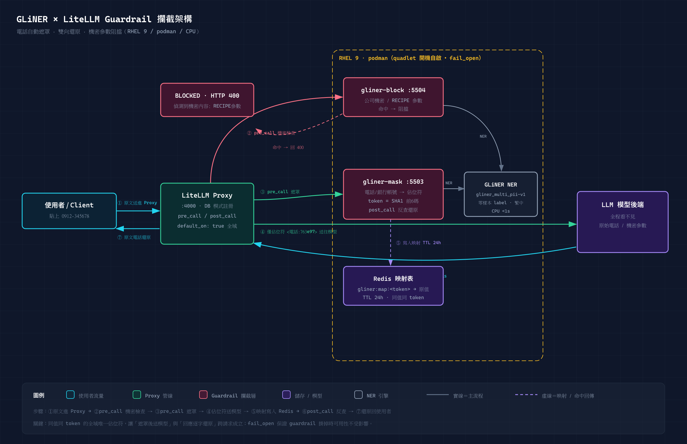

# GLiNER × LiteLLM Guardrail 實戰：繁中機密資料的遮罩、還原與阻擋

公司內部把 LLM 接入 LiteLLM Proxy 之後，一個繞不開的問題是：**員工貼進 prompt 的電話號碼、機台 RECIPE 參數、公司機密文件內容，會原封不動地送到模型端**。這篇文章記錄我在 RHEL 9 + podman 環境，用 GLiNER（零樣本 NER 模型）打造一道「電話自動遮罩、機密內容直接阻擋」的攔截層，並透過 LiteLLM 的 Generic Guardrail API 完整落地的過程——包含所有踩過的坑。

## 需求定義

| 項目 | 決策 |
|---|---|
| 偵測範圍 | 電話號碼（繁中/英文語境）、公司機密資料、機台 RECIPE 參數 |
| 模型 | 必須支援繁體中文 |
| 部署形態 | podman 容器（RHEL 9 無 Docker） |
| 預設動作 | 電話 → 遮罩（mask）；機密/RECIPE → 阻擋（block） |
| 容錯 | `fail_open`：guardrail 服務掛掉時放行，保全系統可用性 |
| Streaming | 接受「串流回應不還原」的限制 |

## 整體架構



流量路径：

```
使用者 → LiteLLM Proxy (:4000)
  ├─ pre_call → gliner-block (:5504)   → 命中機密 → HTTP 400 阻擋
  ├─ pre_call → gliner-mask  (:5503)   → 電話 → <電話:763e97> 佔位符 + Redis 映射
  ├─ 模型只看到佔位符（原始電話從不進模型）
  └─ post_call → gliner-mask (:5503)   → 反查 Redis，把佔位符還原成原文
```

關鍵設計：**全域唯一 token**。遮罩時取實值的 SHA1 前 6 碼作為佔位符 ID（如 `<電話:763e97>`），同一個電話在任何請求中都得到同一個 token，並寫入 Redis（key 前綴 `gliner:map:`，TTL 24 小時）。回應階段的 post_call 反查 Redis 即可逐字還原——模型全程看不到實值，使用者卻能拿到完整答案。

## 為什麼選 GLiNER

傳統 PII 偵測靠正則表達式與 Presidio 這類規則引擎，對「0912-345678」這種標準格式有效，但對**語意性機密**（「這條 RECIPE 的腔體溫度是 120°C、壓力 3.2Torr」）完全無力——它沒有固定格式可匹配。

GLiNER 是「零樣本命名實體識別」模型：你給它任意文字標籤清單（例如 `["電話", "機台RECIPE參數", "公司機密資料"]`），它就能在文字中找出對應實體，**不需要為你的場景訓練模型**。選 `urchade/gliner_multi_pii-v1` 是因為它是多語系 PII checkpoint，**涵蓋繁體中文**，且 CPU 推論單句 <1 秒，不需要 GPU。

## 服務端實作

一個 FastAPI 程序內跑兩個 app：`:5503` 遮罩模式、`:5504` 阻擋模式。之所以拆兩個端點，是因為 LiteLLM 的 Generic Guardrail API 契約固定把 `/beta/litellm_basic_guardrail_api` 附加在 `api_base` 後面，同一個 port 無法註冊成兩種行為。

LiteLLM 送來的請求與我們的回應（這是雙方契約的全部）：

```json
// LiteLLM → 我們的服務
{"texts": ["使用者原文"], "input_type": "request", "litellm_call_id": "...", "model": "..."}

// 我們 → LiteLLM
{"action": "GUARDRAIL_INTERVENED", "texts": ["遮罩後文字"]}   // 攔截並改寫
{"action": "BLOCKED", "blocked_reason": "偵測到機密內容: 機台RECIPE參數 x2"}  // 阻擋
{"action": "NONE"}                                            // 放行
```

核心邏輯濃縮：

```python
def mask_text(text):
    ents = model.predict_entities(text, MASK_LABELS, threshold=THRESHOLD)
    for e in sorted(ents, key=lambda x: -x["start"]) :  # 由後往前取代，避免位移
        token = sha1(e["text"].encode()).hexdigest()[:6]
        placeholder = f"<{e['label']}:{token}>"
        redis.setex(f"gliner:map:{token}", 86400, e["text"])
        text = text[:e["start"]] + placeholder + text[e["end"]:]
    return text

def block_check(text):
    ents = model.predict_entities(text, BLOCK_LABELS, threshold=THRESHOLD)
    if ents:
        hits = " x".join([f"{e['label']}" for e in ents])
        return {"action": "BLOCKED", "blocked_reason": f"偵測到機密內容: {hits}"}
    return {"action": "NONE"}
```

模型載入放在程序啟動時（不在第一次請求時才載入），避免首筆請求超時。

## 容器化：Containerfile 的相依性地雷

```dockerfile
FROM docker.io/library/python:3.11-slim-trixie
RUN pip install --no-cache-dir torch --index-url https://download.pytorch.org/whl/cpu && \
    pip install --no-cache-dir gliner fastapi uvicorn redis tiktoken protobuf "transformers<5"
COPY app.py /app/app.py
CMD ["python", "/app/app.py"]
```

三個**必加**的相依，缺一直接啟動崩潰（每個都燒過一次）：

- `tiktoken` — GLiNER import 链深處依賴，錯誤訊息不明顯
- `protobuf` — 新版 gliner/transformers 相依
- `"transformers<5"` — transformers 5.x 與 gliner 0.2.x 不相容

torch 必用 CPU index URL 安裝，否則 slim 基底會拉下 2GB+ 的 CUDA 版。

模型權重（約 600 MB）掛 volume 快取（`-v /root/ai/gliner/hf:/data/hf` + `HF_HOME=/data/hf`），容器重建不用重下載。預載用一支 `dl.py` 跑 `GLiNER.from_pretrained()` 把權重拉齊，避免上線後首請求卡十分鐘。

## 開機自啟：quadlet `.container`

RHEL 的 podman 生態裡，quadlet 是把容器寫成 systemd unit 的官方方式：

```ini
# /etc/containers/systemd/gliner.container
[Container]
Image=localhost/gliner-guardrail:latest
ContainerName=gliner-guardrail
PublishPort=0.0.0.0:5503:5503
PublishPort=0.0.0.0:5504:5504
Volume=/root/ai/gliner/hf:/data/hf:Z
AddHost=host.docker.internal:host-gateway
Environment=REDIS_HOST=host.docker.internal
Environment=MODEL_ID=urchade/gliner_multi_pii-v1
PodmanArgs=--memory=4g

[Service]
Restart=always

[Install]
WantedBy=multi-user.target
```

`systemctl enable --now gliner` 之後，`gliner.service` 就接管了容器生命週期：開機自動起、當掉自動重啟。`AddHost=host.docker.internal:host-gateway` 讓容器內用 `host.docker.internal` 連宿主機的 Redis。

**quadlet 版本注意事項**：RHEL 9 的 quadlet 支援 `.container` 型別，但 `.compose` 型別不支援（實測 generator 靜默跳過）。要管 docker-compose 棧請改寫 systemd oneshot service 包 `podman-compose up -d / down`。另外 `enable` 步驟偶發失敗不影響——quadlet generator 在開機時會自動產生 unit 並掛進 target。

## LiteLLM 註冊：本趟最貴的三個教訓

LiteLLM 跑在 DB 模式（`STORE_MODEL_IN_DB=True`）時，**config.yaml 裡的 guardrails 設定會被靜默忽略**——不報錯、log 無痕。唯一生效路徑是 REST API 註冊：

```bash
curl -X POST http://localhost:4000/guardrails \
  -H "Authorization: Bearer <master-key>" -H 'Content-Type: application/json' \
  -d '{
  "guardrail": {
    "guardrail_name": "gliner-pii-mask",
    "guardrail_info": {"description": "GLiNER 電話遮罩與雙向還原"},
    "litellm_params": {
      "guardrail": "generic_guardrail_api",
      "api_base": "http://host.docker.internal:5503",
      "mode": ["pre_call", "post_call"],
      "mask_request_content": true,
      "mask_response_content": true,
      "default_on": true,
      "unreachable_fallback": "fail_open"
    }
  }
}'
```

### 教訓一：per-key 綁定 guardrails 是 Enterprise 功能

標準做法是把 guardrail 綁到特定 API key（`/key/generate` 帶 `"guardrails": [...]`）。實測直接 403：

> per-key guardrails are only available in LiteLLM Enterprise

**免費版的唯一全域啟用方式是 `default_on: true`**——guardrail 套用到 proxy 上所有流量。遮罩/還原對使用者透明，全域開啟沒有副作用；阻擋規則則要把 threshold 調保守（我們用 0.55）避免誤傷。

### 教訓二：mode 可以用陣列

文件上 `mode` 常寫成單字串，實測 `["pre_call", "post_call"]` 合法——**同一條 guardrail 同時遮罩請求與還原回應**，不用拆成「遮罩一條、還原一條」兩條註冊。

### 教訓三：更新 guardrail 只認 REST

- ✅ `PUT /guardrails/{guardrail_id}`（body 同建立時的 guardrail dict，含 `guardrail_id`）
- ❌ `POST /guardrails/update` → 405
- ❌ `PUT /guardrails/update` → 「Guardrail with ID update not found」

`guardrail_id` 從 `GET /v2/guardrails/list` 取。

## 驗證：每一層都留證據

號稱裝好了不算數，逐層驗證：

| 驗證點 | 方法 | 結果 |
|---|---|---|
| 服務存活 | `GET :5503/health` | `status: ok`，模型已載入 |
| 電話遮罩 | `POST /scan` 帶「我的手機是 0912-345678」 | → `<電話:763e97>`；`+886-912-345-678` 與英文句子亦命中 |
| Redis 映射 | `redis-cli get gliner:map:a7a93c` | 回 `0987-654321`，TTL 86374 秒 |
| 雙向還原 | 合約端點帶 `input_type=response` + 佔位符 | 原文電話完整還原，`restored:1` |
| 機密阻擋 | RECIPE 溫度/壓力參數句 | `BLOCKED: 偵測到機密內容: 機台RECIPE參數 x2`（信心 0.64-0.78） |
| 生效鏈 | 回應 header | `x-litellm-applied-guardrails: ...,gliner-block,gliner-pii-mask` |

最後一個是神器：**`x-litellm-applied-guardrails` 回應標頭直接列出該請求實際套用的 guardrail 鏈**，不用猜註冊有沒有生效。搭配「guardrail 服務端 access log 有沒有 POST」交叉驗證——因為 `fail_open` 會把「連不上 / 沒綁定」偽裝成「檢查通過」，除錯期間務必看服務端 log，零 POST 就是沒生效。

## 已知限制（誠實清單）

1. **串流回應不還原**：post_call 對 streaming 無法改寫，串流中佔位符會原樣送出。非串流完全正常。
2. **「公司機密資料」零樣本偵測偏邊界**（信心 0.41-0.46）：沒有關鍵字出現的機密句偵測不穩。對策：已知專屬名詞疊 `litellm_content_filter` 關鍵字過濾（正則層），GLiNER 專攻語意層（RECIPE 參數這類），兩層疊加才完整。要更準需收集 50-100 筆實例語料微調 label。
3. **延遲**：CPU 推論每層約 0.2-0.5 秒，pre+post 全程多 ~1 秒。對話延遲敏感的話可換 GPU 或蒸餾模型。
4. **echo 端到端演示需要模型後端對 VM 可達**：本環境模型伺服器只綁 127.0.0.1，最後一哩以合約級驗證取代。

## 維運速查

```bash
# 服務狀態 / 日誌
systemctl status gliner
podman logs -f gliner-guardrail

# 目前所有遮罩映射
podman exec litellm-redis redis-cli --scan --pattern 'gliner:map:*'

# 調整閾值（threshold 預設 0.55）
# 改 /root/ai/gliner/guardrail/app.py 的 _LABELS / env THRESHOLD
systemctl restart gliner

# guardrail 註冊清單
curl -H "Authorization: Bearer <master-key>" \
  http://localhost:4000/v2/guardrails/list
```

## 結語

這套組合的價值在於**零訓練成本**：GLiNER 的零樣本能力讓「機台RECIPE參數」這種完全私有的實體類別，用一行 label 字串就能開偵測；LiteLLM 的 Generic Guardrail API 則是標準化插座，任何 HTTP 服務都能插進去當攔截層。電話遮罩＋雙向還原讓模型「看不見」個資但使用者毫無感知的體驗，在免費版 LiteLLM 上透過 `default_on` 全域模式就能落地。

踩坑成本最高的三件事：per-key 綁定的 Enterprise 403（設計上要走 default_on）、容器相依套件的地雷（tiktoken / protobuf / transformers<5）、以及 `fail_open` 對除錯的欺騙性（一定要看服務端 log 與套用標頭）。希望這篇幫你把它們全部跳過。
