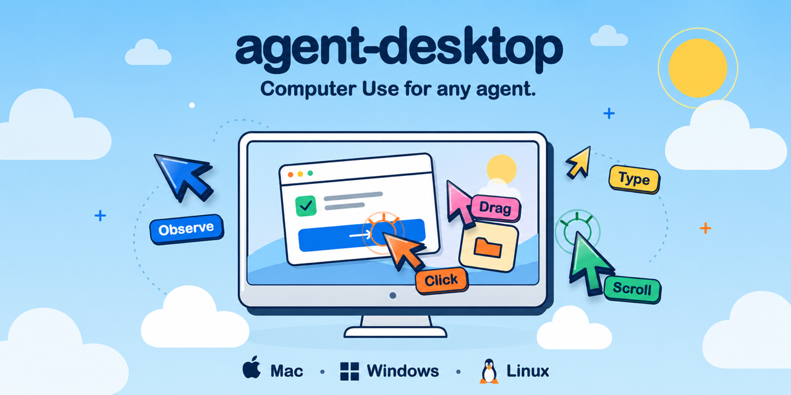

# Agent Desktop：讓 AI Agent 看懂並操作任何桌面 App 的 Rust 底層引擎



**Agent Desktop**（`vercel-labs/agent-desktop`）是 Vercel Labs 出品的「電腦操作基礎設施」：**給任何 AI agent 可靠的桌面電腦使用能力**。它不看像素、不做圖片辨識，而是直接讀取作業系統的**無障礙樹（Accessibility Tree）**——就是螢幕閱讀器用的那套 UI 結構——把每個可操作元素變成帶編號的 `ref`，agent 對 ref 下指令、再重新觀察驗證結果。

一句話：**截圖方案是「猜像素」，Agent Desktop 是「讀結構」。**

## 專案概況

| 項目 | 資料 |
|---|---|
| 倉庫 | [github.com/vercel-labs/agent-desktop](https://github.com/vercel-labs/agent-desktop) |
| Star / Fork | **~7,200 / ~530**（2026-11-02 查證） |
| 語言 / 授權 | **Rust** / Apache-2.0 |
| 建立時間 | 2026-02-19，活躍開發中（最後推送 2026-11-01） |
| 正式版本 | **v1.0.0（2026-10-28）**、v1.0.2（2026-10-30）——上週剛 1.0 |
| 官方網站 | [agent-browser.dev/desktop](https://agent-browser.dev/desktop)（同 agent-browser 團隊的桌面版） |
| 安裝 | `npm install -g agent-desktop`（含 x64/ARM64 原生二進位），或 GitHub Releases 直接下載 |
| 平台 | macOS / Windows / Linux（AT-SPI）全支援 |

## 為什麼不用截圖 + 座標點擊？

主流 computer-use 方案（截圖 → 視覺模型 → 輸出 x,y 座標）的三大痛點，這個專案逐一點名解決：

| 截圖方案的痛點 | Agent Desktop 的做法 |
|---|---|
| **像素猜測不可靠**：小按鈕、縮放、相似圖示容易點錯 | 讀 OS 無障礙樹，元素有 role、name、native ID，語義明確 |
| **ref 會漂移**：UI 變動後座標失效，點了錯誤目標還不自知 | ref 綁定 snapshot ID；UI 變動回 `STALE_REF`/`AMBIGUOUS_TARGET`，**fail-closed 拒絕亂點** |
| **動作不敢重試**：點擊不確定有沒有成功，重試可能雙擊送出 | 每個錯誤附 `disposition`，只有 `retry: safe` 才建議重試；觀察→行動→再觀察的迴圈天然可驗證 |

底層還有嚴謹的**身分驗證機制**：視窗 handle 會被 OS 回收重用，它用「handle + process 產生世代權杖」配對，視窗被換掉時解析失敗而不是誤點新 occupant；截圖前後做雙重身分檢查（Identity Sandwich），捕捉中途螢幕重排就丟棄位元組。

## 核心工作迴圈

```bash
agent-desktop snapshot --app Finder -i      # 觀察：互動元素全部帶 ref
agent-desktop click @s8f3k2p9:e8            # 對 snapshot 裡的 ref 行動
agent-desktop snapshot --app Finder -i      # 再觀察驗證結果
```

`snapshot` 回傳 JSON，樹上每個可操作節點有 `ref_id` 與 `available_actions`：

```json
{ "role": "treeitem", "name": "Documents",
  "ref_id": "@s8f3k2p9:e8", "available_actions": ["Click"] }
```

重點設計：
- **ref 屬於它的 snapshot**：裸 `@e8` 直接拒絕（`INVALID_ARGS`），杜絕跨快照誤用
- **預設無頭（headless）**：透過無障礙 API 操作，**不動滑鼠、不搶焦點**——你的游標照常用，agent 在背景操作；`--headed` 才允許實體輸入
- **密集應用兩步走**：先 `--skeleton --compact` 畫地圖，再 `--root @ref` 鑽進局部樹
- **多視窗不猜**：回 `AMBIGUOUS_TARGET` 並列出候選 window id

## 60 個命令的全能力面

| 群組 | 命令 |
|---|---|
| 觀察 | `snapshot`、`find`、`get`、`is`、`screenshot`、`list-surfaces` |
| 對 ref 行動 | `click`/`double-click`/`triple-click`/`right-click`、`type`、`set-value`、`clear`、`focus`、`select`、`toggle`、`check`/`uncheck`、`expand`/`collapse`、`scroll` |
| 鍵盤滑鼠 | `press`、`hover`、`drag`、`mouse-move`、`mouse-click`、`mouse-wheel`（按壓類命令需 daemon 保護才開放） |
| App／視窗 | `launch`、`close-app`、`list-apps`、`list-windows`、`focus-window`、`resize-window`、`move-window`、`minimize`/`maximize`/`restore` |
| 系統通知 | `list-notifications`、`dismiss-notification`、`notification-action` |
| 剪貼簿 | `clipboard-get`/`set`/`clear` |
| 其他 | `wait`、`batch`（批次命令）、`session`/`trace`（稽核軌跡）、`cursor-overlay` |

每條命令輸出**單一 JSON envelope**：`ok` + `data` 或 `error`（含 `code`、`disposition`、`suggestion`），機器可解析、agent 可據以決策。

## 三平台能力矩陣

| | macOS | Windows | Linux |
|---|:---:|:---:|:---:|
| 無障礙樹 | ✅ AX API | ✅ UIA | ✅ AT-SPI |
| 點擊/輸入 | ✅ | ✅ | AT-SPI + X11/GNOME |
| 滑鼠輸入 | ✅ | ✅ | X11（`--headed`） |
| 截圖 | ✅ | ✅ | X11；Wayland 走 portal |
| 通知操作 | ✅ | ✅ | GNOME Shell |

macOS 需給「無障礙」權限（`agent-desktop permissions --guide` 有引導）；Windows 同完整性層級免授權；Linux 需要圖形 session + `at-spi2-core`。

## 給 AI Agent 的整合方式

1. **自帶文件**：二進位內建與版本匹配的教學——`agent-desktop skills get desktop`（迴圈/refs/驗證/重試規則）、`skills get platform`（你這台 OS 的差異表）。Agent 用之前先讀，文件永遠跟版同步。
2. **Skills 安裝**：`npx skills add https://github.com/vercel-labs/agent-desktop --skill agent-desktop`，或貼幾行到 `AGENTS.md`。
3. **C FFI 綁定**：每版附 `libagent_desktop_ffi`（macOS/Linux/Windows × x64/ARM64），程式可直接 in-process 呼叫，不用每條命令開 CLI——Python `ctypes` 範例現成。

## 工程品質亮點（讀 CONCEPTS.md 的收穫）

這個專案對「正確性」的偏執程度少見，值得學：

- **證據三態**：每個屬性讀取結果分 `Known / Absent / Unknown`，絕不壓成布林——「問了說沒有」和「讀不到」是兩回事，防止把「無法判定」當成「確定不是」
- **分級解析（Graded Resolution）**：重 identifiy 一個 ref 依序走：儲存路徑 → native ID → 角色條件穩定文字 → 幾何位置（僅最後手段且需唯一匹配）
- **Web Wrapper 跳層**：Electron/Chromium 應用的匿名容器鏈吃掉深度預算，自動識別「透明腳架」跳過，讓密集 web app 塞得進預設深度
- **四態讀取裁決**：Settled Absence（永不重試）/ Retryable Failure（值得重試）/ Unavailable Element / Terminal Failure，避免對結構上不可能成功的讀取燒完整個 deadline

## 隱私注意

Snapshot、剪貼簿讀取、截圖、命令輸出**都可能含桌面私密內容**，別丟公開 log。可選的 JEV helper 會把螢幕描述送給設定的模型供應商，屬獨立元件自行評估。

## 適用場景

- **AI agent 要操作桌面軟體**：填舊 ERP 表單、操作沒有 API 的傳統應用、自動化跨應用程式工作流
- **後台/RPA 現代化**：headless 背景操作不搶使用者滑鼠鍵盤
- **agent harness 整合**（Claude Code、Hermes 這類）：裝 skill 後 agent 直接獲得桌面操控力——本機 Hermes 的 computer_use 工具就是同類思路，可互相參照
- **測試自動化**：JSON 輸出 + trace 稽核軌跡，比截圖方案可斷言性高

## 與同類方案比較

| | Agent Desktop | 截圖+視覺模型（Anthropic Computer Use 等） | 腳本橋（AppleScript / pywinauto） |
|---|---|---|---|
| 觀察來源 | OS 無障礙樹（語義） | 像素（猜） | 各平台專用 API |
| 跨平台 | ✅ 三平台統一 JSON | 看模型供應商 | ❌ 各寫各的 |
| 動作安全 | ref fail-closed、安全重試旗標 | 點錯風險高 | 因腳本而異 |
| 需要 LLM 視覺能力 | ❌ 純結構，小模型也能 drive | ✅ 必須強視覺模型 | ❌ |
| 整合成本 | npm 裝完即用 + 自帶 agent skills | 供應商綁定 | 開發量大 |

## 參考資料

- GitHub：[https://github.com/vercel-labs/agent-desktop](https://github.com/vercel-labs/agent-desktop)
- 官方站：[https://agent-browser.dev/desktop](https://agent-browser.dev/desktop)
- 概念詞彙表：[CONCEPTS.md](https://github.com/vercel-labs/agent-desktop/blob/main/CONCEPTS.md)
- JSON 輸出契約：[docs/json-output.md](https://github.com/vercel-labs/agent-desktop/blob/main/docs/json-output.md)
- 安裝與權限：[docs/install.md](https://github.com/vercel-labs/agent-desktop/blob/main/docs/install.md)
