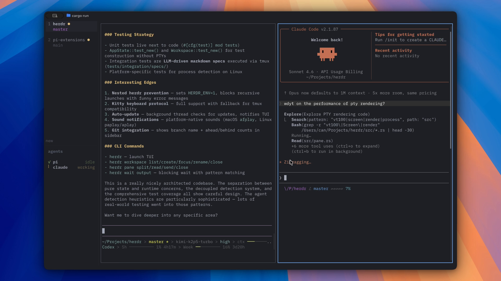

# Herdr：讓 Coding Agent 住進去的終端執行時


**Herdr**（`herdrdev/herdr`，官方站 [herdr.dev](https://herdr.dev/)）的口號是 **「the runtime your coding agents live on」**——你的 AI coding agent 居住的「執行時」。它是一個 **Rust 單一到檔的終端工作區管理器**：像 tmux 一樣把終端進程跑在背景伺服器裡，但它懂 agent——知道每個 pane 裡跑的是 Claude Code 還是 Codex、現在是在幹活還是在等你批准。

一句話：**tmux 管終端，Herdr 管「跑 agent 的終端」。**

## 專案概況

| 項目 | 資料 |
|---|---|
| 倉庫 | [github.com/herdrdev/herdr](https://github.com/herdrdev/herdr) |
| Star / Fork | **~47,400 / ~3,800**（2026-11-02 查證） |
| 語言 / 授權 | **Rust**（單一到檔，無 Electron）/ Apache-2.0 |
| 建立時間 | 2026-03-27，高速活躍（最後推送 2026-11-01） |
| 最新版本 | v0.9.5（2026-10-14），文件多語系：英/日/簡中 |
| 安裝 | `curl -fsSL https://herdr.dev/install.sh \| sh`、`brew install herdr`、`mise use -g herdr`；Windows 有 PowerShell 安裝腳本與端點防護版 |
| 平台 | Linux / macOS / Windows（本地端），遠端主機 Linux/macOS/Windows x86_64+aarch64 |



## 核心概念：四層結構 + 五種 agent 狀態

```
Workspace（一個 repo/任務）→ Tab（agents/logs/server/review 視圖）→ Pane（真實終端）→ Agent（被識別的進程）
```

每個 agent 有五種狀態，**側邊欄逐級向上彙報**——blocked 的 agent 會讓它的 pane、tab、workspace 全部變紅：

| 狀態 | 意義 |
|---|---|
| `blocked` | **需要你**：出現批准、提問、權限對話框 |
| `working` | 正在跑 |
| `done` | 完成了但你還沒看過 |
| `idle` | 完成/等待中且已看過 |
| `unknown` | 無法判定（不假裝知道） |

這就是 Herdr 的主工作流：**同時開好幾個 agent，看側邊欄就知道哪個專案要拍板、哪個還在跑、哪個可以驗收**——不用逐個終端輪詢。

## 七大賣點

### 1. 斷線不中斷（detach without stopping）
背景伺服器持有所有 pane；關掉視窗、SSH 斷線都不影響 agent 繼續跑。`ctrl+b q` 脫離、`herdr` 重連。伺服器/機器重啟後**還原儲存的版面**，支援的 agent 還能接回原本的工作階段（程序本體不存活）。

### 2. 多台機器、一個視窗
本機工作 + 已儲存的 SSH 機器合併成**統一 agent 清單**，各自獨立重連。`herdr --remote workbox` 從本機橋接遠端：遠端跑 pane、本機畫 UI，還能把**本機剪貼簿的圖片**帶進遠端 session 貼上。

### 3. 卡住的會自己出聲
20+ 種 agent 的狀態偵測：Herdr 讀每個 pane 畫面底部的「螢幕清單（manifest）」判定狀態；`blocked` 判定故意嚴格——只有匹配到已知的批准/提問 UI 才算，避免把一般畫面誤判成要你輸入。偵測規則清單會從 herdr.dev **熱更新**，agent 改版後不用升級 Herdr。

### 4. Agent 原生自動化（殺手級）
Agent 自己透過 CLI / Socket API 操作 Herdr：開 pane、啟動别的 agent、丟 prompt、**等對方真正卡住**。官方範例——讓主 agent 叫一個 reviewer 出來審 diff：

```bash
# 右邊切一個新 pane
herdr pane split --current --direction right --no-focus
# 在裡面起一個 codex 命名為 reviewer
herdr agent start reviewer --kind codex --pane "$PANE" -- -m gpt-5.4
# 下 prompt 並等它跑完
herdr agent prompt reviewer "Review the current diff" --wait --timeout 120000
# 讀它的輸出（會自動捲動翻頁取完整歷史）
herdr agent read reviewer --source recent-unwrapped --lines 120
```

防呆設計嚴謹：agent 已 `blocked` 時 `prompt --wait` **直接拒絕送入**（回 `agent_blocked`），不會把文字打进批准對話框；超時不保證沒送出輸入，文件明令「重試前先讀畫面」。支援的 agent 種類 23 種（`--kind claude/codex/opencode/cursor/grok/hermes/...`）。

### 5. 跑你已在跑的
Claude Code、Codex、GitHub Copilot CLI、Cursor Agent、OpenCode、Grok、Devin、Kimi、Qwen Code、Amp、Gemini CLI、Cline……Herdr **不包裝也不取代**它們，只接管終端。Hermes Agent 也在支援清單裡（integration 名 `hermes`）。自己做 agent 的，實作幾個 Herdr CLI/socket 呼叫就能「支援 Herdr」並獲得重啟後自動接回的能力。

### 6. 鍵盤滑鼠都是第一公民
tmux 式 prefix 鍵（`ctrl+b`）+ 完整滑鼠操作：點 pane/tab/workspace/agent、拖分割線、右鍵選單。不想要滑鼠可 `mouse_capture = false`。

### 7. 外掛與市集
panes 與工作流可擴充，有官方 [plugin marketplace](https://herdr.dev/plugins/)。

## Agent 整合方式（給 AI 代理裝的 skill）

官方提供 agent skill 檔：`npx skills add https://github.com/herdrdev/herdr --skill herdr -g`。內建安全護欄：**agent 偵測 `HERDR_ENV=1` 不存在就停下來declare自己不在 Herdr 裡**，防止場外 agent 亂控不屬於它的 session。

## 適用場景

- **多 agent 平行開發**：同時跑 3~5 個 Claude Code/Codex 開任務，側邊欄看誰要拍板——這是 Herdr 的主場景
- **SSH 遠端長任務**：在伺服器上跑數小時的 agent 工作，筆電關蓋、網路斷線都不影響；重連 `herdr` 全部還在
- **agent 編排腳本**：CI  watcher、互審流程（一個實作、一個審查）、agent 團隊互傳訊息與等待
- **取代 tmux 給 agent 時代用**：你需要 tmux 的持久化，但想要「懂 agent 狀態」的現代版
- **多機器儀表板**：本機 + 幾台雲端/工作站的 agent 全部收進一個視窗

## 與同類方案比較

| | Herdr | tmux | 各家 agent 內建背景模式（Claude Code backgrounds 等） | Conductor / Vibe Kanban 類 GUI |
|---|---|---|---|---|
| 持久化背景伺服器 | ✅ | ✅ | 部分 | 看產品 |
| 懂 agent 狀態（working/blocked/done） | ✅ 20+ 種 | ❌ | 僅自家 | 部分 |
| agent 互相編排 API | ✅ CLI+Socket | 無語意 | 有限 | GUI 為主 |
| 多機器統一清單 | ✅ SSH | 手動 | ❌ | 部分 |
| 單一 Rust 到檔、跑在既有終端 | ✅ | ✅ | ❌ 綁工具鏈 | Electron 居多 |

## 小提醒

- Antigravity/Grok 回到提示符就算 idle，背景子任務還在跑時 `agent wait` 可能提早返回
- 遠端 manifest 熱更新只補偵測規則；全新 agent 仍要升級 Herdr 本體
- 在 Herdr pane 裡再自動進 tmux 會讓 Herdr 只看到 tmux 看不到 agent（文件有解法：加 `HERDR_ENV` 檢查）
- Windows 為 beta 支援；遠端 Windows ARM64 主機走 x64 模擬、best-effort

## 參考資料

- 官方站與文件：[https://herdr.dev/docs/](https://herdr.dev/docs/)（[Quick start](https://herdr.dev/docs/quick-start/) · [Concepts](https://herdr.dev/docs/concepts/) · [Agents](https://herdr.dev/docs/agents/) · [Agent automation](https://herdr.dev/docs/agent-automation/) · [Socket API](https://herdr.dev/docs/socket-api/)）
- GitHub：[https://github.com/herdrdev/herdr](https://github.com/herdrdev/herdr)
- Agent skill：[skills/herdr/SKILL.md](https://github.com/herdrdev/herdr/blob/v0.9.5/skills/herdr/SKILL.md)
