# Ruflo（原 Claude Flow）：Claude Code 與 Codex 的 Agent Meta-Harness 功能總覽


## 專案基本資訊

| 項目 | 內容 |
|---|---|
| 倉庫 | [ruvnet/ruflo](https://github.com/ruvnet/ruflo) |
| 定位 | Claude Code / Codex 的 agent meta-harness（代理執行層） |
| 語言 | TypeScript（Rust 編譯的 WASM 核心） |
| 授權 | MIT |
| 星數 / 派生 | **80,741** / 9,481（2026-11-03 取自 GitHub API） |
| 建立日期 | 2025-06-02（首個 commit 即 Claude Flow 的原始構想） |
| 最近推送 | 2026-11-03；最新 release **v3.71.0**（2026-11-01） |
| npm 版本 | `claude-flow` 3.71.0；Node.js ≥ 20 |
| 貢獻者 | 73（API `contributors` 查詢） |
| 官網 / 生態 | [cognitum.one](https://cognitum.one)、[ruv.io](https://ruv.io) |


### 一句話定位

> **Agent = Model + Harness.** 模型負責寫，harness 提供工具、記憶、迴圈、沙箱與控制，讓代理真的能做事。Ruflo 就是這層 harness：在 Claude Code 與 Codex 外面加上 100+ 專用代理、蜂群協調、自我學習記憶、跨機器聯邦與企業級安全護欄。

原名 Claude Flow，由 Reuven Cohen（rUv）建立，2025-06-02 的第一個 commit 描述「Claude 寫、改、測、再改」的遞迴代理循環；名稱後改為 Ruflo（Ru = rUv，flo = 工作到凌晨三點），底層由 Cognitum.One 的 Rust 引擎、embeddings、記憶與插件系統支撐。

---

## 一、兩種安裝路徑（差異極大，先選對）

| | Claude Code Plugin | CLI 安裝（`npx ruflo init`） |
|---|---|---|
| 提供什麼 | Slash 命令 + 少量 skills + 各插件自帶代理定義 | 完整 Ruflo 迴圈：代理、60+ 命令、30 skills、MCP server、hooks、daemon |
| 工作區檔案 | **零** | `.claude/`、`.claude-flow/`、`CLAUDE.md`、helpers、settings |
| MCP server 註冊 | 僅 `ruflo-core` 安裝時自帶 `.mcp.json`，其餘插件多數沒有 | 是 |
| Hooks | 無 | 有 |
| 適合 | 只想試單一插件命令 | 正式使用、照文件全功能運作 |

**Path A：Claude Code 插件（lite）**

```text
/plugin marketplace add ruvnet/ruflo
/plugin install ruflo-core@ruflo
/plugin install ruflo-console@ruflo
/plugin install ruflo-mods@ruflo
/reload-plugins
/ruflo
```

`ruflo-core` 自帶 MCP server，工具名為 `mcp__plugin_ruflo-core_ruflo__*`（如 `memory_store`），不是 CLI 軌道的裸名 `memory_store` / `swarm_init` / `agent_spawn`。

**Path B：CLI（完整迴圈）**

```bash
# 互動式精靈（PowerShell / cmd 也適用）
npx ruflo@latest init wizard

# 非互動
npx ruflo@latest init

# 全域安裝
npm install -g ruflo@latest
```

POSIX shell（macOS / Linux / WSL / Git-Bash）可用一行安裝：

```bash
curl -fsSL https://cdn.jsdelivr.net/gh/ruvnet/ruflo@main/scripts/install.sh | bash
```

**Windows 注意**：`curl ... | bash` 需要 POSIX shell（Git-Bash、WSL、MSYS）；原生 PowerShell / cmd 請用 `npx ruflo@latest init wizard`，否則會出現 `'bash' is not recognized`。

**MCP server 註冊**

```bash
claude mcp add claude-flow -- npx ruflo@latest mcp start
# 或本地 stdio 客戶端設定：command = npx，arguments = ["-y","ruflo@latest","mcp","start"]
npx -y ruflo@latest mcp start
```

**可選純終端機 TUI**（不需 Claude Code）：`npx ruflo tui`，加上 `--plain` 可輸出單一框供腳本使用；畫面含 Overview、Cost、Swarm、Events、Missions 與可選 AI 頁。



---

## 二、能力清單（含數字核實）

README 行銷文案寫「100+ 代理」「314 MCP 工具」「26 CLI 命令」「33 原生插件 + 21 npm 插件」；`docs/STATUS.md` 寫 323 工具 / 45 命令 / 33 插件 / 45 代理；但倉庫內的 `verification/inventory.json` 實際列出：

| 表面 | 核實數量（inventory.json） |
|---|---|
| MCP 工具 | **305**（分 29 個工具模組） |
| CLI 頂層命令 | **49** |
| 插件（`plugins/ruflo-*`） | **32** |
| 代理定義 | **44** |

> 誠實提醒：README、STATUS 與 inventory 三處數字互相不一致；STATUS.md 的快照仍停在 `ruflo@3.10.2`，屬過期資料。文章以 inventory.json 為準，行銷數字僅供參考。



### 主要能力對照表

| 能力 | 說明 |
|---|---|
| **100+ 專用代理** | 寫碼、測試、審查、架構、安全、文件、GitHub 自動化等 |
| **通訊層 / 聯邦** | 零信任 federation：跨機器、跨組織的代理互相發現、認證、交換工作 |
| **蜂群協調** | 階層式、網狀、環狀、星型、混合、自適應拓撲，加上共識機制 |
| **自我學習** | SONA 神經模式、ReasoningBank、軌跡學習 |
| **向量記憶** | HNSW 索引 AgentDB；README 稱 N=20k 約 1.9 倍、N=5k 約 3.2–4.7 倍快於暴力搜尋（recall@10 約 0.99），小 N 時 ANN 會打平或變慢 |
| **背景工作者** | 12 個自動觸發 worker（audit、optimize、testgaps 等） |
| **插件市集** | 原生 Claude Code 插件 + npm 插件；Console 內 `/ruflo market` 為 Plugin Catalog |
| **多供應商路由** | Claude、GPT、Gemini、Cohere、Ollama，含 failover |
| **安全** | AIDefence、輸入驗證、CVE 修補、路徑穿越防護 |
| **MetaHarness** | 為你的 agent 設定打分（1–100）、掃描工具設定風險、專案快照追蹤回歸，並可 `ruflo eject` 變成獨立工具包 |

---

## 三、蜂群與共識：核心架構



```
User --> Claude Code / CLI
          |
          v
    Orchestration Layer
    (MCP Server, Router, 27 Hooks)
          |
          v
    Swarm Coordination
    (Queen, Topology, Consensus)
          |
          v
    100+ Specialized Agents
    (coder, tester, reviewer, architect, security...)
          |
          v
    Memory & Learning
    (AgentDB, HNSW, SONA, ReasoningBank)
          |
          v
    LLM Providers
    (Claude, GPT, Gemini, Cohere, Ollama)
```

**拓撲選擇**

| 拓撲 | 建議代理數 | 適用 | 啟動時間 | 每代理記憶 |
|---|---|---|---|---|
| Hierarchical | 6+ | 結構化任務、明確權限鏈 | 0.20s | 256 MB |
| Mesh | 4+ | 協作、高冗餘 | 0.15s | 192 MB |
| Ring | 3+ | 循序管線 | 0.12s | 128 MB |
| Star | 5+ | 集中控制、輻射式 worker | 0.14s | 180 MB |
| Hybrid（Hierarchical-Mesh） | 7+ | 多領域複雜任務 | 0.18s | 320 MB |
| Adaptive | 2+ | 動態負載、自動擴縮 | 變動 | 動態 |

**五種共識演算法**

| 演算法 | 投票方式 | 容錯 | 適用 |
|---|---|---|---|
| Byzantine | 2/3 超級多數 | f < n/3 | 關鍵決策 |
| Raft | 領袖選舉 | f < n/2 | 強一致狀態 |
| Quorum | 可配置（多數/超級多數/全體） | 取決於門檻 | 可調共識 |
| Gossip | 流行病式傳播 | 最終一致 | 大型對等網路 |
| CRDT | 無衝突合併 | 分區容忍 | 分散式共享狀態 |

**Hive Mind**：三種女王（Strategic 規劃、Tactical 執行、Adaptive 最佳化）+ 八種 worker（researcher、coder、analyst、tester、architect、reviewer、optimizer、documenter），集體記憶分 `knowledge`、`context`（1h TTL）、`task`（30min）、`result`、`error`（24h）、`metric`（1h）、`consensus`、`system`。



---

## 四、記憶與學習



- **AgentDB / HNSW**：向量索引 + SQLite + 可選 PostgreSQL；`CLAUDE_FLOW_MEMORY_TYPE` 可選 `json`、`sqlite`、`agentdb`、`hybrid`。
- **RVF**：跨 session 保存與還原代理記憶。
- **RuVector 插件**：GPU 加速搜尋、Graph RAG、103 工具。
- **知識圖譜**：實體關係建構與遍歷；另有 graph-intelligence 的子線性推理（PageRank、delta 更新）。
- **Hyperbolic embeddings（Poincaré ball）**、Int8 量化（約 4 倍節省）、SQL 內 39 種 attention 機制。
- **SONA / ReasoningBank / 軌跡對比學習**：成功的 trajectory 與任務回饋可影響後續路由；效果取決於記憶配置、學習模組與回饋品質。

> 概念示意：Recall → Execute → Evaluate → Store → Adapt → Reuse。本地向量檢索與對比更新可不需 LLM，但 embeddings 與學習模組仍必須配置。

---

## 五、聯邦：代理的「Slack」



| 能力 | 運作方式 |
|---|---|
| 零信任聯邦 | 遠端代理預設不受信任；mTLS + ed25519 challenge-response 證明身分，不用 API key 或共享秘密 |
| PII 閘門 | 14 類偵測管線掃描每則外送訊息；依信任等級採 BLOCK / REDACT / HASH / PASS |
| 行為信任分 | `0.4×success + 0.2×uptime + 0.2×threat + 0.2×integrity`；升級需歷史，降級立即 |
| 合規 | HIPAA / SOC2 / GDPR 稽核軌跡；事件以結構化紀錄存入 HNSW 可搜尋 |
| 工具與命令 | 9 個 MCP 工具 + 10 個 CLI 命令（init、join、send、trust、audit…） |

```bash
npx claude-flow@latest federation init
npx claude-flow@latest federation join wss://team-b.example.com:8443
npx claude-flow@latest federation send --to team-b --type task-request \
  --message "Analyze transaction patterns for account anomalies"
npx claude-flow@latest federation status
```

選配的 WireGuard mesh 層把封包層可達性綁到聯邦信任；另有 ADR-097 預算斷路器（預設 `maxHops: 8`，錯誤原因為常數字串，避免 oracle 洩漏）。

---

## 六、安全


**AIDefence**（<10ms）：prompt injection、jailbreak、PII 掃描、記憶污染與代理串謀偵測。

**7 層防護**：輸入驗證、沙箱、命令注入阻擋、路徑穿越防護、bcrypt（12+ rounds）、安全憑證生成、CVE 主動掃描。

**近期硬化（audit 批次）**：
- `github-safe.js`、statusline、GitHub tools、`update/executor` 的命令注入缺口已關閉。
- `terminal_create` 邊界拒絕 `LD_PRELOAD`、`NODE_OPTIONS`、`DYLD_*` 等 loader-hijack 環境變數。
- session / terminal / memory store 強制 0600 檔案權限。
- MCP stdin 10 MB 上限，防未換行輸入造成 OOM。
- `verify` 與 IPFS HEAD 探測加上 fetch timeout。

**加密落地（ADR-096 四階段）**：AES-256-GCM vault、`RFE1` magic-byte 格式、`CLAUDE_FLOW_ENCRYPT_AT_REST=1`（預設關閉以保住 1865 測試基線）、覆蓋 `sessions/`、`terminals/`、`.swarm/memory.db`。

---

## 七、Console 座艙與 Claude 控制



- **工作流、代理、模型、token、成本** 一覽；可開代理日誌與結果、搜尋、分診失敗、重播與比較。
- **Claude control**：`read` / `write` / `manage` / `full` 四級，搭配 `ask` 或 `auto` 核准；預設為 **read + ask**。超權限動作會被拒絕；網路、花費、破壞性動作即使 `auto` 也要確認。可看 live action log，或按 **Take back control** 停止。
- **Theme Studio**：Orbital 主題、六種調色盤、自訂、儲存主題、JSON 匯入、視窗縮放。
- 插件：`ruflo-console`（座艙）、`ruflo-mods`（路由與政策強制）、`ruflo-swarm`（蜂群面板）、`ruflo-ruos`（ruOS 狀態段）。

```text
/plugin marketplace add ruvnet/ruflo
/plugin install ruflo-console@ruflo
/plugin install ruflo-mods@ruflo
/reload-plugins
```

> Mods 以你的帳號權限執行、**不在沙箱內**，安裝前必須先讀程式碼。


---

## 八、Codex 與 Hermes 等外部客戶端整合

- `npx ruflo init --codex` 產生 `AGENTS.md`（而非 `CLAUDE.md`）；`--codex --full` 帶上全部 skills。
- `codex mcp add ruflo -- npx ruflo mcp start` 把 MCP 註冊進 Codex。
- Dual-mode：Claude Code 互動開發 + 無頭 Codex worker 平行背景任務；模板 `feature`（architect→coder→tester→reviewer）、`security`（scanner→analyzer→fixer）、`refactor`（analyzer→planner→refactorer→validator）。
- 原則：**Codex 做執行（寫碼、跑命令），Claude 負責協調與學習。**
- TUI 的 AI 頁可用 Codex 或 OpenRouter 提問，但只讀 pinned `0.162.0` 的 Codex 版本（`0.162.1` 會崩），且僅該頁能送出請求、每次先詢問。
- `--grok` 會寫出 `.grok/`、團隊 bus 與操作指南，僅限專案內；`--dry-run` 可預覽。

---

## 九、MetaHarness：稽核你的 agent 設定

- 就緒度打分 **1–100**。
- 掃描工具設定中的安全風險。
- 快照整個專案，跨次比對抓回歸。
- 找出符合你 repo 的模板。
- `ruflo eject` 把 ruflo 專案轉成有自己名字的獨立 agent 工具包。

```bash
ruflo doctor --fix   # 診斷並修復安裝
ruflo verify         # 驗證安裝位元組與簽章見證一致
```

**驗證機制**：每個修復以 Ed25519（金鑰由 git commit 推導）簽署；`ruflo verify` 抓 manifest、重算每個檔案 SHA-256、重建公鑰、驗簽章；任何檔案漂移會非零退出並指出出問題的檔案。完整 300 工具 / 49 命令的逐能力見證仍在進行中。

---

## 十、插件生態

**核心與協調**：ruflo-core、ruflo-swarm、ruflo-autopilot、ruflo-loop-workers、ruflo-workflows、ruflo-federation。

**記憶與知識**：ruflo-agentdb、ruflo-rag-memory、ruflo-rvf、ruflo-ruvector、ruflo-knowledge-graph。

**智慧與學習**：ruflo-intelligence、ruflo-graph-intelligence、ruflo-daa、ruflo-ruvllm、ruflo-goals。

**程式品質與測試**：ruflo-testgen、ruflo-browser、ruflo-jujutsu、ruflo-docs。

**安全與合規**：ruflo-security-audit、ruflo-aidefence。

**架構與方法論**：ruflo-adr、ruflo-ddd、ruflo-sparc、ruflo-metaharness、ruflo-arena。

**DevOps 與可觀測性**：ruflo-migrations、ruflo-observability、ruflo-cost-tracker。

**擴充性**：ruflo-agent（本地 WASM 沙箱 rvagent + Anthropic Claude Managed Agents）、ruflo-plugin-creator。

**領域專用**：ruflo-iot-cognitum、ruflo-neural-trader、ruflo-market-data。

**外部插件**（各自維護）：`agentic-qe-fleet`（11 個 QE 代理、覆蓋率、chaos、TDD）、`agentdb`（pinned 3.2.0）、`agentic-flow`（pinned 3.1.0，預設 readonly）。三者只能從一個 marketplace 安裝，否則 mod 與命令會載入兩次。

---

## 十一、與其他框架的對照

| 能力 | Claude Code 單獨 | + Ruflo |
|---|---|---|
| 代理協作 | 各自隔離、無共享上下文 | 蜂群、共享記憶與共識 |
| 協調 | 手動編排 | 女王階層（Raft / Byzantine / Gossip） |
| 記憶 | 僅 session | HNSW 向量記憶，次毫秒檢索 |
| 學習 | 靜態行為 | SONA 自我學習 + 模式匹配 |
| 任務路由 | 你自己決定 | 智慧路由（宣稱 89% 準確） |
| 背景 worker | 無 | 12 個自動觸發 |
| LLM 供應商 | 僅 Anthropic | 5 家 + failover |
| 安全 | 標準防護 | CVE 硬化 + AIDefence |

**對照 CrewAI / LangGraph / AutoGen / Manus**（USERGUIDE 表）：Ruflo 在蜂群拓撲（4 類 vs 各 1）、共識協議（5 種）、工作所有權（claims 系統）、背景 worker、多供應商（6 家 failover）、MCP（原生）、skills（42+）、串流管線、結對程式（driver/navigator）、自動更新含回滾、AIDefence 上均有優勢；競爭框架大多標為不支援。

**基準宣稱**：v3.8.0 SOTA matrix 對 LangGraph / AutoGen / CrewAI 在 darwin-arm64 + linux-x64 上，Ruflo 在 cold start、single turn、RSS 勝出 1.3×–1953×。原矩陣 JSON 在 `perf/sota-comparator-benchmarks` 分支，可自行重現。

---

## 十二、生態延伸

- **ruOS Desktop**（`https://ruos.cognitum.one`）：可透過 MCP `https://ruos.cognitum.one/mcp` 連 ChatGPT / Claude。
- **RuVector**：`npx ruvector`，本地向量搜尋、持久上下文、圖關係、回饋學習。
- **ChatGPT 插件**：RuFlo Federation 已上架 ChatGPT 插件目錄。

---

## 十三、使用注意與風險

1. **數字不一致**：README（314 工具 / 26 命令 / 33 插件）、STATUS（323 / 45 / 33 / 45）、inventory.json（305 / 49 / 32 / 44）。引用時要看是哪份文件；STATUS 快照已過期。
2. **插件不是沙箱**：`ruflo-mods` 等以你的帳號權限執行，安裝前先讀原始碼。
3. **Windows 安裝**：`curl | bash` 需 POSIX shell；原生環境用 `npx`。
4. **外部插件只能單一來源安裝**，否則重複載入。
5. **Claude Code 版本要求**：插件路線需 Claude Code 2.1.287 以上。
6. **聯邦需要基礎設施**：mTLS、身分、稽核與 WireGuard mesh 屬選配，預設不會替你管理證書。
7. **基準數據需自行重現**：README 的 gist 與分支矩陣可查，但作者自行量測，跨平台差異大。

---

## 參考資料

- 專案：[github.com/ruvnet/ruflo](https://github.com/ruvnet/ruflo)
- 使用者指南：[docs/USERGUIDE.md](https://github.com/ruvnet/ruflo/blob/main/docs/USERGUIDE.md)
- 狀態文件：[docs/STATUS.md](https://github.com/ruvnet/ruflo/blob/main/docs/STATUS.md)
- 能力清單：[verification/inventory.json](https://github.com/ruvnet/ruflo/blob/main/verification/inventory.json)
- MetaHarness 指南：[docs/metaharness-user-guide.md](https://github.com/ruvnet/ruflo/blob/main/docs/metaharness-user-guide.md)
- 驗證：[verification.md](https://github.com/ruvnet/ruflo/blob/main/verification.md)
- 基準：[gist 298f8c668c8859b369f91734a0e9cbbe](https://gist.github.com/ruvnet/298f8c668c8859b369f91734a0e9cbbe)
- 插件市集：[ruvnet.github.io/ruflo](https://ruvnet.github.io/ruflo)
- 官方網站：[cognitum.one](https://cognitum.one)
