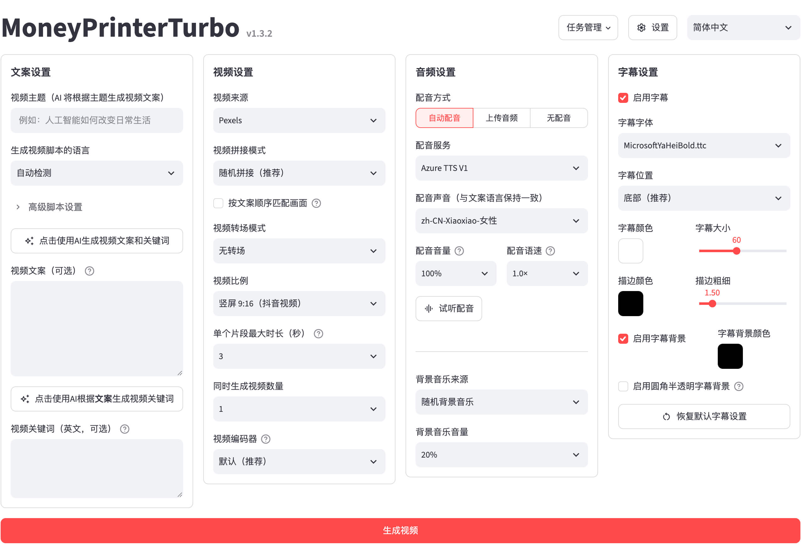
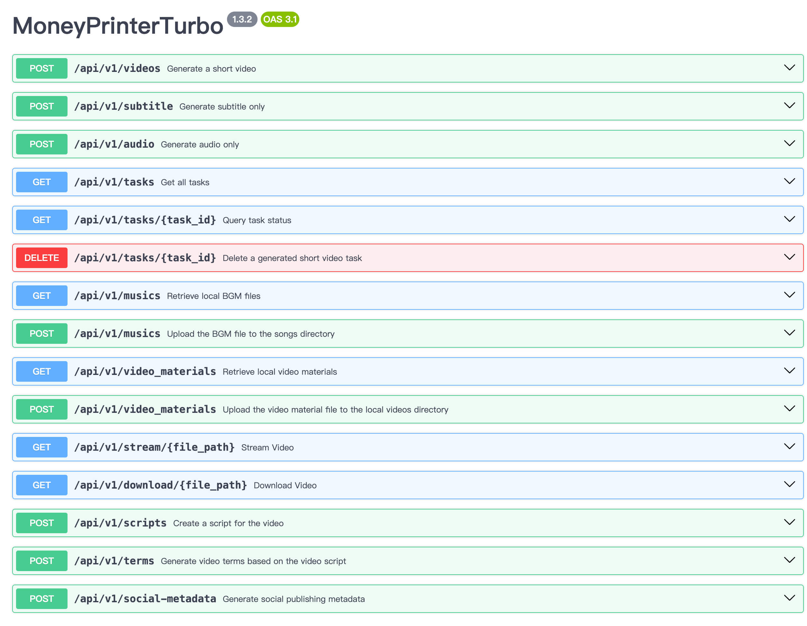

# MoneyPrinterTurbo 功能總覽：一句主題，自動產出高清短影片

**MoneyPrinterTurbo** 是一個「一站式 AI 短影片產生工具」：只要提供影片**主題**或**關鍵字**，它就會自動生成影片腳本、搜尋或生成畫面素材、合成配音與字幕、加上背景音樂，最後剪輯合成一支高清短影片，並可一鍵上傳到 TikTok、Instagram 與 YouTube Shorts。整個流程從文案到成片完全自動化，也允許在每個環節改用自產內容。

| 專案資訊 | 數值 |
| --- | --- |
| 倉庫 | [harry0703/MoneyPrinterTurbo](https://github.com/harry0703/MoneyPrinterTurbo) |
| Stars / Forks | 142,374 / 22,759 |
| 授權 | MIT |
| 主要語言 | Python（約 4.1 MB 程式碼，另有少量 CSS/Shell） |
| 最新版本 | v1.3.10（2026-11-07 發布） |
| 建立時間 | 2024-03-11，至今持續活躍更新 |
| 執行環境 | Windows 10 / macOS 11+ / Linux，Python 3.11+ |

專案自 2024 年 3 月建立以來成長快速，是 GitHub 上 Star 數最高的 AI 影片產生開源專案之一，更新節奏穩定（v1.3.9、v1.3.10 都在 2026 年 11 月初接連發布）。

## 介面總覽

WebUI 以 Streamlit 打造，左側是生成設定（主題、語言、畫幅、配音、字幕樣式等），右側為任務進度與成片預覽；另外提供 FastAPI 的 REST API 文件介面，可整併到自動化流程。





## 核心工作流程

輸入一個主題後，系統依序完成六個環節，每個環節都可替換成自訂內容：

```text
主題／關鍵字
   │
   ├─① LLM 產生多語影片腳本（或貼上自寫腳本）
   ├─② TTS 語音配音（自動／上傳配音檔／無配音）
   ├─③ 素材取得：庫存網站、AI 文生影片、上傳本地圖影片
   ├─④ 字幕產生（TTS 時間戳或 Whisper 轉錄）
   ├─⑤ 背景音樂（隨機／本地／AI 生成）
   └─⑥ FFmpeg + MoviePy 剪輯合成 → 9:16、16:9、1:1 成片
                                        │
                                        └─ 一鍵發布 TikTok / Instagram / YouTube Shorts
```

## 功能特性詳解

### 1. 創作入口與工作流

| 入口 | 說明 |
| --- | --- |
| AI Agent | 將專案的 `docs/skill/SKILL.md` 連結貼給支援 Skill 的 AI 助理，它會自動完成安裝、設定與影片產出（支援 macOS / Windows），缺 API 金鑰時才會詢問使用者 |
| WebUI | 圖形介面，瀏覽器開啟 `http://127.0.0.1:8501` |
| API | FastAPI 服務（預設 port 8080，`/docs` 為 OpenAPI 文件），適合接 n8n 等自動化流程 |
| CLI | `cli.py` 純命令列產片，無需瀏覽器；`--batch-file` 可批次執行最多 100 個任務（UTF-8 JSON 清單），單筆失敗不影響後續，結束輸出 JSON 彙總 |

其他工作流能力：**批次產生多支成片**、任務歷史記錄、生成設定與 API 金鑰的匯入／匯出／回覆。

### 2. 腳本與模型服務

腳本支援 AI 自動產生或改寫**多語言**影片文案，也可直接使用自訂腳本。模型端的廣度是這個專案的最大賣點：

- **主流模型服務**：Kimi / Moonshot AI、OpenAI、Anthropic Claude、Google Gemini、DeepSeek、阿里雲通義千問、Azure OpenAI、火山引擎方舟、xAI Grok、MiniMax、小米 MiMo 等。
- **統一閘道／聚合平台／本地環境**：Cloudflare AI Gateway、OpenRouter、LiteLLM、OneAPI、Ollama、魔搭 ModelScope、AIHubMix、AIML API、Groq、Pollinations AI 等 OpenAI 相容端點皆可串接。
- v1.3.10 起另支援 **OpenAI Codex 訂閱登入**（裝置碼登入＋動態模型選取）與 **ChatGPT Native OAuth** 提供器，可直接沿用訂閱額度而不用另買 API。

對已有自建推理服務（例如 LiteLLM Proxy 或 Ollama）的使用者來說，几乎零成本就能把這套工具接進現有環境。

### 3. 影片與圖片素材

| 素材來源 | 說明 |
| --- | --- |
| 庫存網站 | Pexels（免費）、Pixabay（免費）、Coverr 的高清圖庫影片 |
| 本地上傳 | 上傳自備圖片與影片，完全脫離線上素材 |
| 秘塔 MiniMax H3 文生影片 | 768P / 2K、4～15 秒原始素材，支援 9:16、16:9、1:1 |
| 火山引擎方舟 Seedance | 原生接續，依腳本片段產生連貫畫面 |
| 勝算雲 AI 影片 | 多段 AI 素材，沿用同一套配音／字幕／剪輯流程 |
| WaveSpeed、OFox、MuAPI | 多家文生影片 API（OFox 一組金鑰可調用 Seedance、Wan 等；MuAPI 非同步 3～12 秒素材） |
| OpenAI 相容文生圖 | 串雲端或自建圖片閘道，將生成圖片轉為帶緩慢縮放效果的動態片段 |

片段層面可調整**時間長度、畫面適配方式與素材匹配順序**，以配合不同畫幅與敘事節奏。

### 4. 配音、字幕與配樂

**語音合成（TTS）**：內建 Edge TTS（免費、免 API 金鑰，預設的 Azure TTS V1 即基於它），另整合 Azure Speech V2、SiliconFlow、Google Gemini TTS、小米 MiMo、MiniMax、ElevenLabs、自架 Chatterbox / Kokoro、Fish Audio、ModelBest VoxCPM。VoxCPM 還支援**上傳參考音訊複製說話者音色**（可保留節奏與情緒）。提供音色試聽與完整配音預覽，並可選擇「自動配音／上傳配音／無配音」三種模式。

**字幕產生**提供兩種策略：

| 模式 | 原理 | 特色 |
| --- | --- | --- |
| `edge`（預設） | 直接用 TTS 回傳的時間戳 | 速度快、不需要 GPU |
| `whisper` | 本地 `faster-whisper` 轉錄音訊 | 時間軸更準；首次需下載模型（`large-v3` 約 3 GB，或 `large-v3-turbo` 約 1.6 GB） |

字幕可調字體、位置、顏色、大小、描邊與背景樣式；v1.3.10 加入**阿拉伯文字幕整形**（連字、RTL 排版、混排字形回溯）。

**背景音樂**：從 `resource/songs` 隨機选用、指定本地音樂，或使用 **AI 生成配樂**（ElevenLabs Music），音量可獨立控制。

### 5. 成片與發布

- 三種畫幅：直式 `9:16（1080×1920）`、橫式 `16:9（1920×1080）`、方形 `1:1（1080×1080）`。
- 一鍵**跨平台發布**：產片完成後自動上傳至 **TikTok、Instagram、YouTube Shorts**。
- 任務追蹤可在重新整理頁面後續看進度，並有重複提交防護與輪詢狀態顯示（v1.3.10）。

## 技術架構

以 Python 單體架構為主，WebUI、API、CLI 共用同一層服務：

```text
┌─ webui/Main.py（Streamlit，單檔即完整介面）
├─ main.py → FastAPI（app/controllers/v1，port 8080）
├─ cli.py（命令列與批次清單）
│
└─ app/services/（核心服務層，37 個模組）
   ├─ llm.py        腳本生成、多模型适配（62 KB）
   ├─ material.py   素材搜尋／AI 文生影片接入（141 KB）
   ├─ voice.py      各家 TTS 服務整合（163 KB）
   ├─ video.py      剪輯合成管線（97 KB）
   ├─ subtitle.py   字幕產生
   ├─ bgm.py        背景音樂
   ├─ task.py       任務佇列與狀態（可共用 Redis 併發上限）
   └─ 各供應商模組（elevenlabs / metaso / ofox / volcengine_seedance …）
```

關鍵依賴：`moviepy` + `imageio-ffmpeg`（剪輯）、`streamlit`（UI）、`fastapi` + `uvicorn`（API）、`litellm` / `openai` / `google-genai`（模型接入）、`edge-tts`（免費配音）、`faster-whisper`（字幕轉錄）、`khatt`（阿拉伯文字幕繪製）、`pydub`（音訊處理）。專案有 CI 分支覆蓋率底線（70%）與容器漏洞掃描，工程品質維護相當認真。

## 安裝與部署

| 方式 | 指令／步驟 | 適用對象 |
| --- | --- | --- |
| pip 官方套件 | `pip install mpt` → `mpt webui`（官方 PyPI 包名為 `mpt`；PyPI 上的 `MoneyPrinterTurbo` 是第三方維護） | 已有 Python 環境，想快速使用 |
| Windows 一鍵啟動包 | 到 Releases 下載 `.7z`（注意不是 Source code），先跑 `update.bat` 再跑 `start.bat`；路徑避免中文／空格 | Windows 新手 |
| Docker | `docker compose -f docker-compose.release.yml up`，直接拉取 `ghcr.io/harry0703/moneyprinterturbo:latest`；另有 GPU 版 compose | 想要隔離環境或伺服器部署 |
| 源碼部署 | `uv sync --frozen` 後執行 `webui.bat` / `sh webui.sh`；API 用 `python main.py` | 二次開發 |
| Google Colab | 一鍵開啟 `docs/MoneyPrinterTurbo.ipynb` | 免安裝體驗 |
| AI Agent | 把 `docs/skill/SKILL.md` 連結貼給 Agent 下指令 | 完全免手動設定 |

幾個實用細節：

- 首次啟動依 `config.example.toml` 自動建立 `config.toml`，API 金鑰在 WebUI 基礎設定中填寫即可。
- pip 安裝版的資料目錄：Windows 在 `%LOCALAPPDATA%\MoneyPrinterTurbo`，可用 `MPT_HOME` 覆寫；成片位於其中 `storage/tasks`。
- 想讓區域網路內的裝置共用 WebUI，設定 `MPT_WEBUI_HOST=0.0.0.0` 再啟動。
- API 預設僅容許同源網頁存取，跨源前端才需用 `CORS_ALLOWED_ORIGINS` 白名單；curl / Postman / n8n 等服務端呼叫不受 CORS 限制。

### 硬體需求

| 項目 | 最低 | 建議 | 理想 |
| --- | --- | --- | --- |
| CPU | 4 核心 | 6～8 核心 | 8 核心以上 |
| 記憶體 | 4 GB | 8 GB | 16 GB 以上 |
| GPU | 非必需 | 4 GB 記憶體以上 | 8 GB 記憶體以上 |

若主要使用雲端 LLM、雲端 TTS 與線上素材，CPU 與記憶體比 GPU 重要；啟用本地 `faster-whisper`、批次產生或较重本地處理時，GPU 才有明顯幫助。

## 常見問題速查

- **`No ffmpeg exe could be found`**：ffmpeg 通常會自動下載；失敗時自行從 gyan.dev 下載並在 `config.toml` 設定 `ffmpeg_path`。
- **`Too many open files`**：以 `ulimit -n 10240` 調高檔案開啟數上限。
- **Whisper 模型下載失敗**：改從 Hugging Face 手動下載 `whisper-large-v3`，整份資料夾放到專案 `models/whisper-large-v3`。

## 近期動態（v1.3.10）

- 新增 OpenAI Codex 訂閱存取與 ChatGPT Native OAuth 提供器，以及 Codex 圖片生成作為素材來源。
- 新增 Infistar、Jalapeno Cloud 等 LLM／影片生成服務。
- 長效影片產生加入階段進度、經過時間與輪詢狀態；任務於頁面重新整理後仍可追蹤。
- 阿拉伯文字幕整形、更平滑的圖片緩慢縮放、新增印尼語介面。
- Redis 任務併發上限跨 worker 共用（原子化槽位預留與續約）。

## 總結評價

**亮點**

- 一條龍完成「腳本→配音→素材→字幕→配樂→剪輯→發布」，每個環節都能自動化也能人工接管。
- 模型供應商覆蓋極廣，從免費的 Edge TTS、Pexels 到各大雲端的 LLM / TTS / 文生影片都能接，也支援 OpenRouter、LiteLLM、Ollama 等中介閘道與本地模型。
- 四種入口（Agent / WebUI / API / CLI）加上 pip、Docker、一鍵包，部署彈性高，MIT 授權可自由商用。
- 維護活躍：本檔撰寫當下為 142k+ 星，v1.3.10 發布於 2026-11-07，修復與新功能節奏穩定。

**限制與注意**

- 本質是「圖文快剪」型成片：以素材庫與 AI 素材拼貼敘事，不適合需要原創实拍畫面的品牌影片。
- 重度雲端服務依賴：品質與成本取決於所选 LLM / TTS / 文生影片 API 的計費與穩定性；完全免費路線（Edge TTS + Pexels）可行但上限較低。
- 預設內嵌字幕與配樂素材來自網路，商用前請自行確認授權；README 也明確提示預設音樂若有疑慮請自行移除。
- 一次產片的成本與時間仍要以自己串的模型為準，建議先用便宜模型跑通流程再升級。

適合想批量經營短影音內容的創作者、需要內容量產的營運團隊，以及想把影片生成包成 API 的開發者；不適合追求電影級原創畫面的使用者。

---

*資料來源：[MoneyPrinterTurbo README](https://github.com/harry0703/MoneyPrinterTurbo/blob/main/README.md)、GitHub API 與 v1.3.10 發布說明，擷取於 2026-11-11。*
