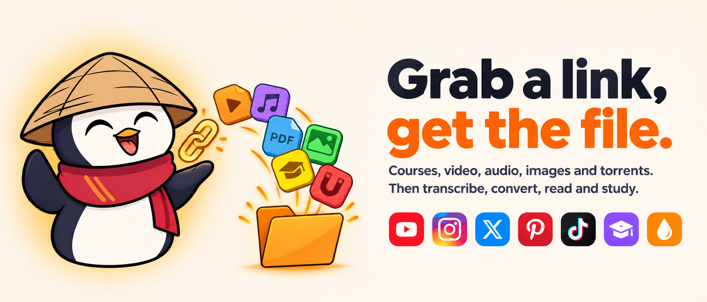
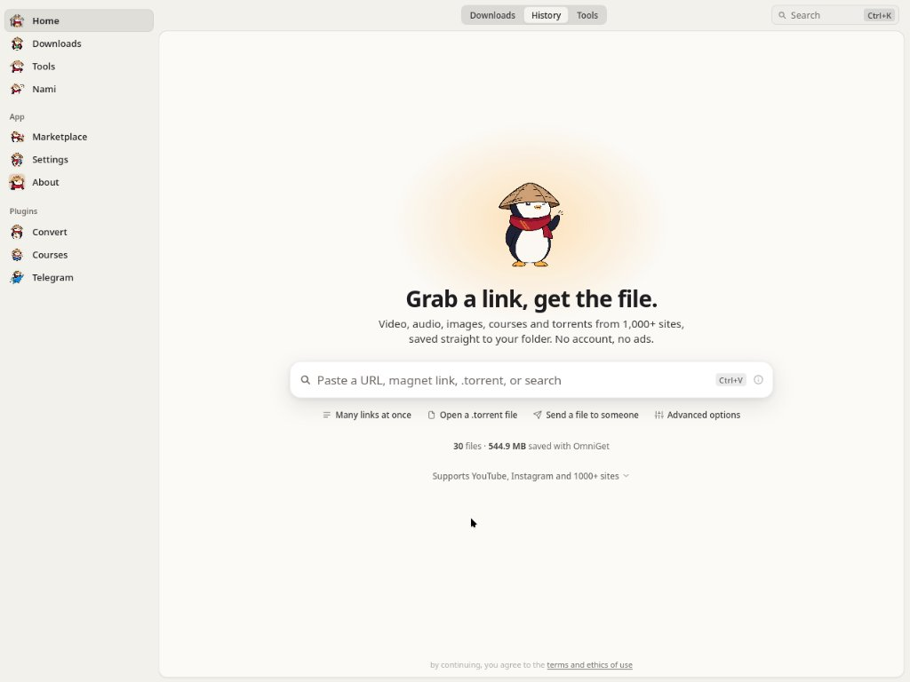
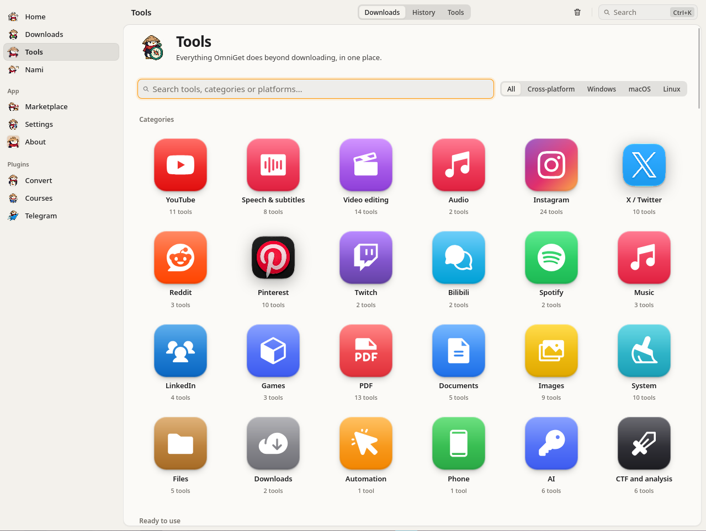

# OmniGet：下載 Udemy 課程、YouTube、IG、1800+ 網站的開源全能下載器——還內建 108 個工具



**OmniGet**（`OpenSelena/omniget`）是一個**免費開源的桌面下載管理器 + 媒體工具箱**：貼連結 → 預覽（含清晰度選項）→ 按下載。Udemy/Hotmart 課程、YouTube、Instagram Reels/限動、X、Pinterest、TikTok、Bilibili、Telegram、種子磁力，以及 **1,800+ 網站**（yt-dlp 引擎）全部收進一個輸入框——**不用命令列、不用記 yt-dlp 參數**。

血統說明：這是 Tonho 原版 OmniGet 的獨立 GPL-3.0 分支，由 [igect](https://github.com/igect) 維護（README 有免責聲明）。

## 專案概況

| 項目 | 資料 |
|---|---|
| 倉庫 | [github.com/OpenSelena/omniget](https://github.com/OpenSelena/omniget) |
| Star / Fork | **~5,470 / ~680**（2026-11-11 查證） |
| 技術棧 | **Tauri 2 + Rust + SvelteKit (Svelte 5)** + SQLite；內嵌 yt-dlp、FFmpeg、gallery-dl、whisper.cpp、aria2、librqbit（種子） |
| 授權 | GPL-3.0；無廣告、免註冊、不下報下載紀錄 |
| 最新版本 | **v0.15.1**（2026-11-09），應用內推更新 |
| 平台 | Windows 10/11（setup/portable/MSI/winget）、macOS 10.15+（Apple Silicon + Intel，Homebrew cask）、Linux（deb/rpm/AppImage，x86_64+ARM64） |
| 介面語言 | **11 種（含繁體中文）**、14 個主題（Catppuccin/Dracula/One Dark…） |

## 為什麼不直接用 yt-dlp？

官方對比表講得很誠實——yt-dlp 是它的引擎，「常住終端機只要檔案的人，直接用 yt-dlp 更合適」。OmniGet 補上的是：

- **零設定**：yt-dlp / FFmpeg 自動安裝、自動更新（執行前核對 SHA-256）；機器上有 Python 3.10+ 時以 zipapp 跑 yt-dlp，啟動不到一秒
- **登入後內容**：瀏覽器擴充轉傳 Cookie/Referer → IG 限動、付費課程、會員影片抓得到（Cookie 按真實網域分組）
- **佇列工程**：斷點續傳、429 退避重試、按站自動調併發（YouTube 16 分片並行）、規則把特定頻道/網域固定送進指定資料夾
- **下載之後**：內建播放器、閱讀器、字幕工坊、記憶卡、108 個工具——不只是吐檔案



## 能下載什麼

| 類別 | 內容 |
|---|---|
| **線上課程** | Courses 插件：**Udemy、Hotmart、Kiwify、Rocketseat**、Meta-Analysis Academy——列出已購課程、勾選章節、抓全部課時+附件；DRM 課時會跳過並告知 |
| 影音 | YouTube（影片/播放列表/頻道/直播從頭錄/SponsorBlock）、IG、TikTok、X、Reddit、Twitch、Vimeo、Bluesky、Threads、Pinterest、抖音 |
| **Bilibili（登入後）** | 按會員等級取 4K/HDR/杜比視界/Hi-Res 無損；彈幕匯出 XML/ASS/JSON；NFO 給 Kodi/Jellyfin；11 種連結類型 |
| 圖庫 | gallery-dl 抓 **250+ 網站**整頁畫廊（DeviantArt、Pixiv、ArtStation、Flickr…） |
| 批次 | 貼多條連結/`.txt`；整個 subreddit、IG/Pinterest/X 主頁 |
| 檔案傳輸 | **內建 BitTorrent 用戶端**（種子+磁力）、HTTP 直鏈、HLS/DASH manifest、兩台 OmniGet 之間用短口令互傳檔案 |
| Telegram | 登入後抓你所在任何頻道/群組的照片、影片、檔案 |

全域快捷鍵：**Ctrl+Shift+D** 全域貼上即下（背景開跑不用開視窗）、**Ctrl+Shift+M** 只要音訊（YouTube 連結一鍵變 MP3）。

## 瀏覽器擴充（抓登入後內容的關鍵）

支援 YouTube、IG、TikTok、X、Reddit、Twitch、Pinterest、Telegram、Udemy、Hotmart、Bilibili 等一站送進 OmniGet（圖示或 **Alt+O**）；在**任何網站**監聽網路流量列出 MP4/HLS/DASH/WebM 串流。安裝走 Chromium「開發者模式＋載入未封裝」三層引導（應用內一鍵輸出擴充資料夾 → 載入 → 配對），Firefox 用臨時附加組件，Safari 暫不支持。配對走 `127.0.0.1:47720-47729` + 每安裝產生的 token——**什麼都不離開你的電腦**。



## Tools 工具區：16 分類 108 個工具

每個工具是一條獨立 Rust 命令（JSON 進出）——這也成為 **MCP server** 的基礎。重點挑幾個：

- **YouTube（11）**：字幕工坊（編輯/翻譯/重校時 SRT/VTT/ASS，帶波形圖+AI 翻譯）、封面瀏覽、評論與章節擷取、直播聊天回放存檔、「真實截圖」（25%/50%/75% 畫面，不看標題黨封面）、SponsorBlock 參數
- **語音與字幕（8）**：**whisper.cpp 離線轉寫**（macOS Metal 加速）、Edge 自然語音 TTS、字幕翻譯保留時間軸、按字幕配音、聽寫（全域熱鍵打字到游標處）
- **Instagram（24）**：抓限動**含密友且不標已讀**、誰看了我的限動、整頁備份、未互關/僵尸粉分析+白名單安全取關、主頁互動率分析、抽獎、排程發文
- **X（10）**：長推串展開存 Markdown、主頁媒體全抓、進階搜尋運算子、書籤匯出、Grok 提問
- **Pinterest（10）**：畫板備份含**增量同步**、無 AI 無廣告搜尋、找原圖出處+Wayback+反搜、畫板色彩盤匯出 hex/CSS
- **PDF（6）／文件（5）**：合併/拆分/壓縮/OCR、SlideShare→PDF、Google Docs 公開檔匯出 DOCX/PPTX/XLSX
- **圖片**：Real-ESRGAN 超分（Vulkan GPU）、批次縮放、OCR
- **系統（9，Windows 多項）**：磁碟分析、遙控 Windows 遙測的隱私護盾、hardentools 加固、winget/choco/scoop 批次更新
- **AI（6）**：模型比價（LiteLLM/models.dev 資料）、Ollama 本地模型管理、**API 金鑰本機保險庫**（可一鍵匯出給 Claude Code/Codex/opencode/.env）、**MCP server 31 工具**——Claude Code / Cursor / VS Code 現成設定片段，讓 agent 直接呼叫 OmniGet 全部能力

## 隱私立場

無帳號、無自家伺服器、不上報下載內容；網路請求只有三類：你要下載的網站、GitHub（更新/插件）、你自配的 AI 服務商。**不繞 DRM、不破付費牆**，只抓「你已登入會話本來就看得到的內容」。

## 安裝速記

```bash
# Windows
winget install -e --id OpenSelena.OmniGet
# macOS
brew install --cask OpenSelena/tap/omniget
```

首次啟動警告屬正常（未買憑證簽章）：Windows SmartScreen 選「仍要執行」；macOS 跑 `xattr -cr /Applications/omniget.app` + ad-hoc codesign 一次即可。Linux AppImage 缺 FUSE2 就 `sudo apt install libfuse2`，或直接裝 `.deb`。Windows 可放 `portable.txt` 變全綠可攜版（塞 U 盤）。

另有 `omniget-cli`：`omniget download <url> -q 1080`、`omniget batch links.txt -m 3`。

## 適用場景

- **買課存檔派**：Udemy/Hotmart 課程在平台下架前整包備到硬碟（含附件）
- **內容創作者**：IG/X/Pinterest 數據分析、抽獎、排程發文、素材備份一站搞定
- **Bilibili 高畫質黨**：會員 4K/杜比視界/無損音頻 + 彈幕存檔進 Kodi/Jellyfin
- **字幕學習者**：離線 whisper 轉寫 + 字幕工坊雙語合成 + AI 翻譯
- **AI 工作流**：MCP server 把「下載+轉寫+PDF」全部變成 Claude Code/Cursor 可呼叫的工具

## 與同類方案比較

| | OmniGet | yt-dlp | 單站網頁下載器 | IDM/NDM | 付費課程下載器 |
|---|---|---|---|---|---|
| 支援網站 | 原生提取器 + 1800+ | 1800+ | 一個 | 通用 HTTP | 一兩平台 |
| 圖形介面/佇列 | ✅ 斷點續傳+退避重試 | CLI 一次一條 | 無 | ✅（無站點解析） | 一般 |
| 登入後內容 | ✅ 擴充帶 Cookie | 手動 `--cookies` | 少 | ❌ | 有時 |
| 課程平台 | ✅ Udemy/Hotmart 等 5 家 | ❌ | ❌ | ❌ | ✅（訂閱制） |
| 下載後工具 | 108 個（轉寫/閱讀/分析） | 檔案 | 常重新編碼 | 檔案 | 檔案 |
| 價格/授權 | 免費 GPL-3.0 | 免費 Unlicense | 免費含廣告 | 付費 | 訂閱 |

## 注意事項

- 未簽章/未公證：首次啟動要手動放行（一次性）
- Instagram「寫操作」（發文/取關）屬外掛自動化，有限流與帳號風險，官方也標 beta 並做節流保護
- DRM 課時抓不了（設計上跳過），平台 TOS 自負
- 不在 Flathub；Linux 用 deb/rpm/AppImage

## 參考資料

- GitHub：[https://github.com/OpenSelena/omniget](https://github.com/OpenSelena/omniget)
- Releases：[https://github.com/OpenSelena/omniget/releases/latest](https://github.com/OpenSelena/omniget/releases/latest)（v0.15.1）
- 官方 README（繁中介面、簡中 README）：[README_zh_CN.md](https://github.com/OpenSelena/omniget/blob/main/README_zh_CN.md)
- Telegram 頻道：[t.me/OpenSelena](https://t.me/OpenSelena) · 翻譯：[Weblate](https://hosted.weblate.org/engage/omniget-openselena/)
