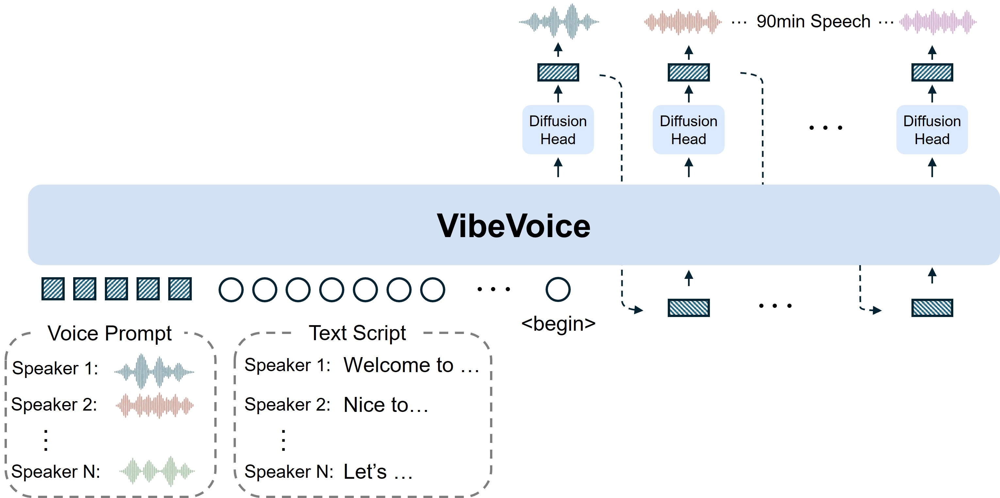
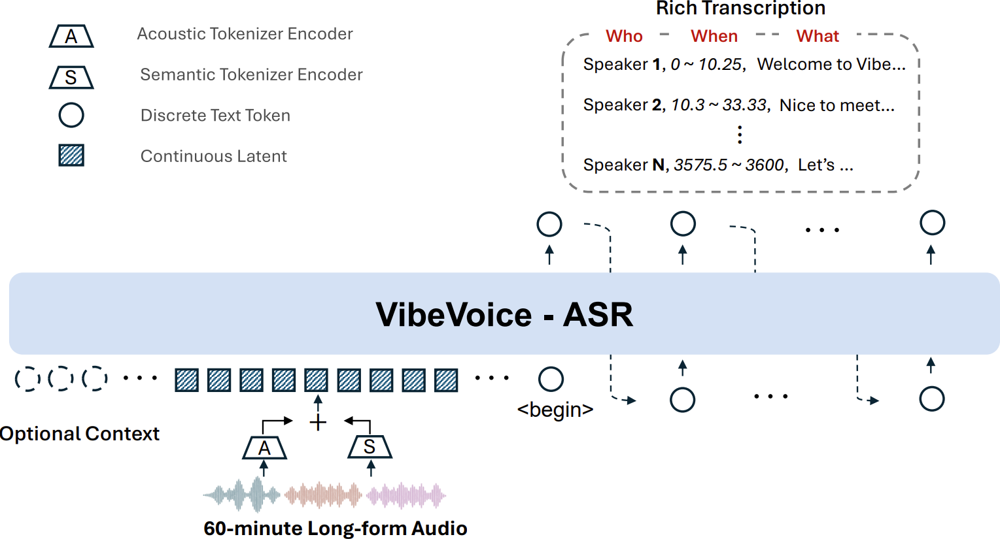
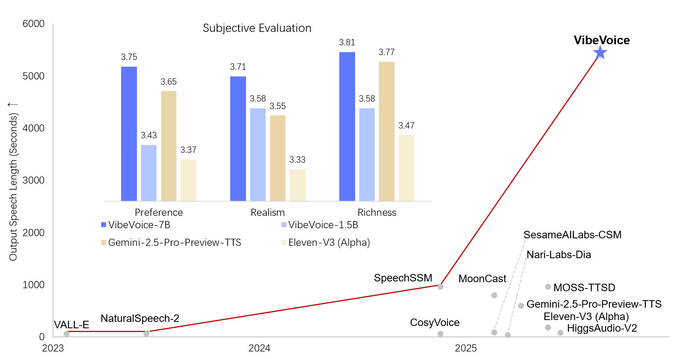
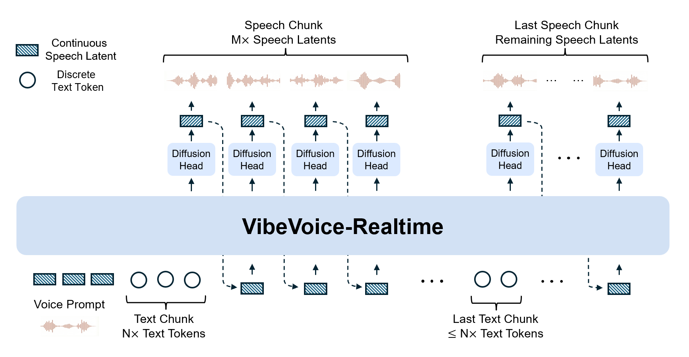

# VibeVoice 功能總覽：微軟開源的頂尖語音 AI 模型家族

**VibeVoice** 是微軟（Microsoft）開源的「頂尖語音 AI 模型家族」（Open-Source Frontier Voice AI），同時涵蓋**文字轉語音（TTS）**與**自動語音辨識（ASR）**兩條產品線。它最出名的兩項能力：一是把**長達 90 分鐘、最多 4 個說話者**的對話文字一次合成為語音；二是一次吃下**最長 60 分鐘**的連續音訊，直接輸出「**誰（Who）在何時（When）說了什麼（What）**」的結構化轉錄。

| 專案資訊 | 數值 |
| --- | --- |
| 倉庫 | [microsoft/VibeVoice](https://github.com/microsoft/VibeVoice) |
| Stars / Forks | 57,017 / 6,428 |
| 授權 | MIT |
| 主要語言 | Python（約 708 KB 程式碼） |
| 建立時間 | 2025-08-25，2026-10 仍在更新 |
| 官方網站 | [microsoft.github.io/VibeVoice](https://microsoft.github.io/VibeVoice) |
| 學術成果 | TTS 論文獲 **ICLR 2026 Oral**；ASR 技術報告刊於 arXiv |
| 模型權重 | 一律發布於 Hugging Face（倉庫不含 release） |

倉庫本身沒有 release 制式版本，模型以 Hugging Face 上的獨立权重發布，程式碼端則持續更新（vLLM 插件、串流推理、邊緣運算引擎等）。

## 核心架構：7.5 Hz 超低幀率語音記號 + Next-Token Diffusion

VibeVoice 的關鍵創新在於**連續語音記號化（continuous speech tokenization）**：

- **聲學（Acoustic）與語意（Semantic）兩套連續記號器**，以超低 **7.5 Hz** 幀率運作——比一般離散語音編碼器的幀率低一個數量級以上，大幅縮短序列長度，讓「一小時語音」能塞進 LLM 的 64K 上下文單次處理。
- 採用 **next-token diffusion** 框架：**LLM 主幹（基於 Qwen2.5）**負責理解文字脈絡與對話流向、产出下一個語音記號；末端接一個**擴散解碼頭（diffusion head）**還原高保真聲學細節。
- 這個「LLM 管語意、擴散頭管音色細節」的分工，是它能同時做到**超長時程一致性**與**高音質**的原因。



## 模型家族矩陣

| 模型 | 尺寸 | 定位 | 權重 | 快速體驗 |
| --- | --- | --- | --- | --- |
| **VibeVoice-ASR** | 7B | 60 分鐘長音訊單次轉錄＋說話者分離＋時間戳 | [Hugging Face](https://huggingface.co/microsoft/VibeVoice-ASR) | [線上 Playground](https://aka.ms/vibevoice-asr) |
| **VibeVoice-ASR-Streaming** | 7B | 邊說邊轉錄，每音訊區塊產出文字，支援熱詞與 10 種語言 | Hugging Face | FastAPI / WebSocket Demo |
| **VibeVoice-ASR-BitNet** | 量化版 | 邊緣 CPU 推理引擎（VibeASR.cpp），免 GPU | Hugging Face | [VibeASR.cpp](https://github.com/microsoft/VibeASR.cpp) |
| **VibeVoice-TTS** | 1.5B（另有 Large） | 90 分鐘、4 說話者長篇語音合成 | Hugging Face（1.5B） | ⚠️ 推理程式已下架 |
| **VibeVoice-Realtime** | 0.5B | 即時串流 TTS，首段語音延遲約 200～300 ms | Hugging Face | Google Colab |

### 1. VibeVoice-ASR：一小時會議一次轉完

傳統 ASR 把音訊切成小區塊處理，容易丟失全域脈絡；VibeVoice-ASR 在 64K 記號長度內**單次接受最长 60 分鐘**連續音訊，全程維持一致的說話者追蹤與語意連貫性。

- **豐富轉錄（Who / When / What）**：同時執行語音辨識、說話者分離（diarization）與時間戳對齊，輸出結構化結果。
- **自訂熱詞（Customized Hotwords）**：提供特定人名、專有名詞或背景資訊作為提示，顯著提升領域內容的準確率。
- **原生多語**：支援超過 **50 種語言**，不需手動設定語言，且能在句內與句間原生處理語碼夾雜（code-switching）。
- **LoRA 微調**：倉庫附完整 LoRA 微調腳本，訓練資料為「音訊＋JSON 標註」成對格式（含說話者、時間區段與可選的自訂脈絡欄位）。
- **工程整合**：已推出官方 **vLLM 插件**加速推理、進入 **Hugging Face Transformers** 正式支援，並上線 **Azure AI Foundry Labs** 可直接體驗。

**實測成績**（DER 為說話者分離錯誤率、cpWER／tcpWER 為含說話者與時間戳的詞錯誤率，皆越低越好）：

| 資料集 | 語言 | DER | cpWER | tcpWER | WER |
| --- | --- | --- | --- | --- | --- |
| MLC-Challenge | 平均 | **3.42** | 14.81 | 15.66 | 12.07 |
| MLC-Challenge | 英文 | 4.28 | 11.48 | 13.02 | 7.99 |
| MLC-Challenge | 日文 | 0.82 | 15.33 | 15.41 | 14.69 |
| AISHELL-4 | 中文 | 6.77 | 24.99 | 25.35 | 21.40 |
| AliMeeting | 中文會議 | 10.92 | 29.33 | 29.51 | 27.40 |
| AMI-SDM | 英文會議 | 13.43 | 28.82 | 29.80 | 24.65 |



### 2. VibeVoice-ASR-Streaming：話還在說，字已經出來

串流變體不等錄音結束，**每個音訊區塊（chunk）產生一次文字**，適合即時字幕、會議直播轉錄。範例提供 FastAPI + WebSocket Demo（本機 `localhost:7870`，可對麥克風即時測試），檔案推理可用 `--context_info` 傳入熱詞。區塊大小與預看視窗寫在 checkpoint 的 `preprocessor_config.json`，保證模型always按訓練時的區塊執行。2026-09 發布，支援 10 種語言。

### 3. VibeVoice-ASR-BitNet：一般 CPU 也能跑的邊緣引擎

2026-07 隨附的 **VibeASR.cpp** 推理引擎，透過**異質量化（I8_S + I2_S）**把模型從 4.62 GB 壓到 **1.58 GB**，在 **3 個以上 CPU 執行緒**就能達到即時推理（RTF < 1）——完全不需要 GPU，適合筆電、嵌入式裝置或隱私敏感的在地轉錄場景。

### 4. VibeVoice-TTS：90 分鐘、4 說話者的播客級合成（程式已下架）

VibeVoice-TTS 是讓這個專案一炮而紅的模型：**單次合成最長 90 分鐘**對話語音、**最多 4 個獨立說話者**，維持跨長對話的音色一致與語意連貫，支援英、中等多語，甚至會出人意料地**即興唱歌**與**在合適時機自己加入背景音樂**（作者刻意保留的彩蛋：訓練資料未去噪）。論文獲 ICLR 2026 Oral。



⚠️ **但要注意**：由於發布後發現被用於與原意不符的場景（Deepfake 風險），微軟於 **2025-09-05 將 TTS 推理程式從倉庫移除**，README 的安裝段落標示「Disabled due to widespread misuse」。目前 1.5B 權重仍在 Hugging Face 上，倉庫中可直接執行的 TTS 入口只剩 0.5B 即時版。

實用的社群經驗（來自官方 FAQ）：中文合成不穩定時改用英文標點、改用較穩定的 Large 變體、語速過快時把文字拆成同一說話者的多個輪次；模型不做文字正規化，複雜符號建議自行預處理。

### 5. VibeVoice-Realtime-0.5B：讓 LLM 從第一個 token 開始說話

輕量即時 TTS，專為「接上任何 LLM、答案還沒生成完就先開口」的場景設計：

- **約 200～300 毫秒**的首段可聽延遲（依硬體而異）；實測 NVIDIA T4 與 Mac M4 Pro 可達即時。
- **串流文字輸入**：視窗交錯（interleaved windowed）設計，增量編碼輸入文字的同時從既有脈絡繼續擴散生成聲學潜變數。
- 0.5B 參數、8K 上下文（約可生成 10 分鐘語音）、單說話者。
- 移除語意記號器、僅保留 7.5 Hz 聲學記號器以換取速度。
- 為降低 Deepfake 風險並壓低首塊延遲，**語音提示採內嵌格式**，不開放任意聲音複製；除英文外另提供德、法、義、日、韓、荷、波、葡、西 9 種實驗性語音。



**零樣本（zero-shot）評測**（WER 越低越好、說話者相似度越高越好）：

| 基準 | VibeVoice-Realtime-0.5B | 對比對象 |
| --- | --- | --- |
| LibriSpeech test-clean | WER **2.00%**，相似度 **0.695** | VALL-E 2（2.40 / 0.643）、Voicebox（1.90 / 0.662）、MELLE（2.10 / 0.625） |
| SEED test-en | WER **2.05%**，相似度 0.633 | MaskGCT（2.62 / 0.714）、Seed-TTS（2.25 / 0.762）、CosyVoice2（2.57 / 0.652） |

以 0.5B 的体量拿到與數倍尺寸模型相當的成績，是它最值得一提的亮點。

## 安裝與使用

官方建議用 **NVIDIA PyTorch 容器**（24.07～25.12 皆驗證）管理 CUDA 環境：

```bash
# 容器內
git clone https://github.com/microsoft/VibeVoice.git
cd VibeVoice
pip install -e .            # ASR；串流 TTS 加 [streamingtts]
apt update && apt install ffmpeg -y

# 三種入口
python demo/vibevoice_asr_gradio_demo.py --model_path microsoft/VibeVoice-ASR --share   # ASR Gradio
python demo/vibevoice_asr_inference_from_file.py --model_path ... --audio_files [路徑]   # 檔案批次轉錄
python demo/vibevoice_realtime_demo.py --model_path microsoft/VibeVoice-Realtime-0.5B   # 即時 TTS WebSocket
```

- 不想裝環境：**ASR Playground**（線上 Gradio）與 **Realtime Colab** 兩種免安裝體驗。
- 量產部署：ASR 走官方 **vLLM 插件**（含串流版伺服器）；已入 Transformers 主線亦可一般方式載入。
- LoRA 微調：`finetuning-asr/` 內含腳本與範例資料集（另裝 `peft`）。
- 依賴：torch、transformers（4.51+）、diffusers、librosa、gradio、fastapi、aiortc 等；Python 3.10+；Flash Attention 建議就緒。

## 發展時間線

| 時間 | 節點 |
| --- | --- |
| 2025-08-25 | 開源 VibeVoice-TTS（90 分鐘多說話者） |
| 2025-09-05 | 因濫用疑慮移除 TTS 推理程式 |
| 2025-12-03 | 開源 Realtime-0.5B 即時串流 TTS |
| 2025-12-16 | Realtime 增 9 國語言與 11 種英文風格語音 |
| 2026-01-21 | 開源 VibeVoice-ASR-7B（60 分鐘統一轉錄）＋微調與 vLLM |
| 2026-03-06 | ASR 進入 Hugging Face Transformers 正式發行 |
| 2026-03-12 | ASR 整合進 Azure AI Foundry Labs |
| 2026-07-23 | ASR-BitNet 邊緣 CPU 引擎（VibeASR.cpp） |
| 2026-09-03 | ASR-Streaming 統一串流辨識（10 語、熱詞） |

## 風險與限制（官方立場）

- **僅供研究**：官方明確表示不建議未經進一步測試即用於商業或真實場景。
- **Deepfake 與假訊息**：高品質合成語音可被濫用於冒充、詐欺與不實訊息；分享 AI 生成內容時最佳實務是揭露 AI 的使用。TTS 程式下架正是此立場的具體行動，Realtime 版也以「內嵌語音提示」限制任意音色複製。
- **继承基座模型缺陷**：偏誤、錯誤與遺漏繼承自 Qwen2.5 基座（TTS 1.5B／Realtime 0.5B／ASR 7B 各對應尺寸）。
- **其他**：TTS 不處理非語音音訊、不生成重疊講話；Realtime 以英文為主，極短輸入（≤3 字）穩定性下降；不支援閱讀程式碼、公式與罕見符號。

## 總結評價

**亮點**

- 架構路線清晰：7.5 Hz 超低幀率記號化把「長音訊」問題轉化為 LLM 擅長的長序列問題，ASR 與 TTS 共享同一套哲學，60/90 分鐘級處理能力至今仍是開源天花板。
- ASR 端工程配套完整：Playground、Colab、Transformers、vLLM、LoRA 微調、CPU 邊緣引擎一應俱全，從试玩到量產都有路。
- Realtime-0.5B 以極小体量提供約 200 ms 級延遲與旗艦級零樣本成績，非常適合接在自己的 LLM 服務前面。
- MIT 授權、微軟背後品質與持續更新的節奏（近一年幾乎每季都有新模型）。

**限制與注意**

- 招牌的 TTS 推理程式已下架，「90 分鐘 4 說話者」目前只剩權重與論文，开箱即用的多說話者合成並不可得。
- 官方定位研究用途，商業落地需自行評估法遵與倫理風險，並自備防濫用措施。
- 中文能力可用但非一線（中文資料量明顯少於英文），TTS 中文穩定性有已知問題，ASR 中文會議成績落後英文。
- 完整功能需要 NVIDIA GPU 環境（NGC 容器＋Flash Attention）；免 GPU 路線目前只有 BitNet ASR 與線上 Demo。

適合想要在地化長音訊轉錄（會議、訪談、播客）的團隊、要給 LLM 加語音輸出的開發者，與做語音生成研究的工作者；不適合想要「現成多說話者配音 API」的商業內容團隊——那條路已被官方刻意關掉。

---

*資料來源：[VibeVoice README](https://github.com/microsoft/VibeVoice/blob/main/README.md) 與 docs/ 模型文件、GitHub API，擷取於 2026-11-11。*
