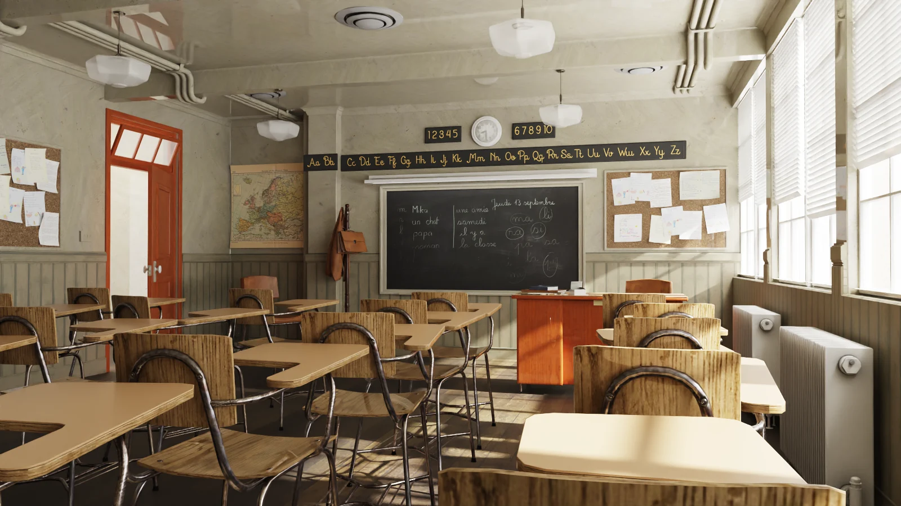
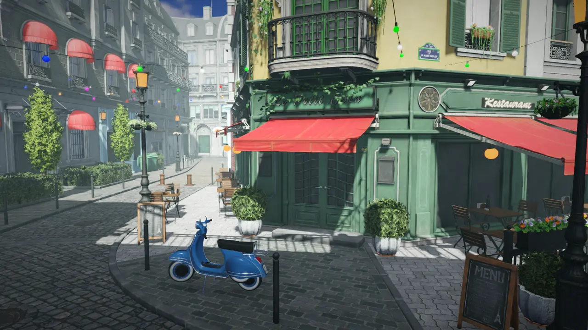
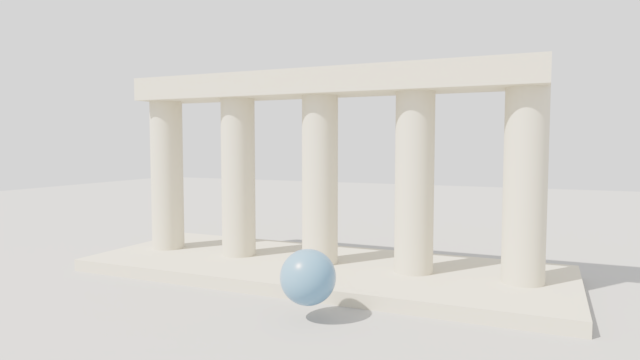
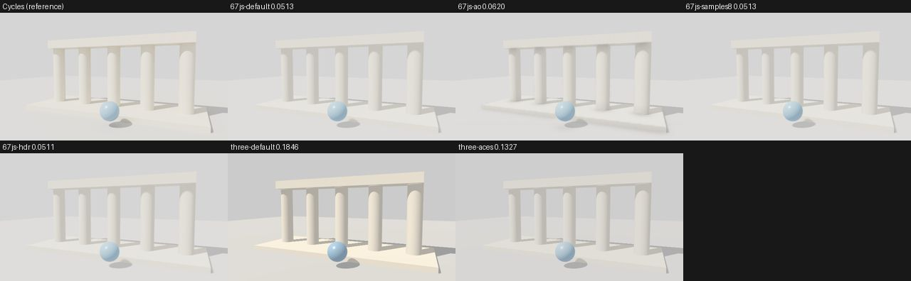
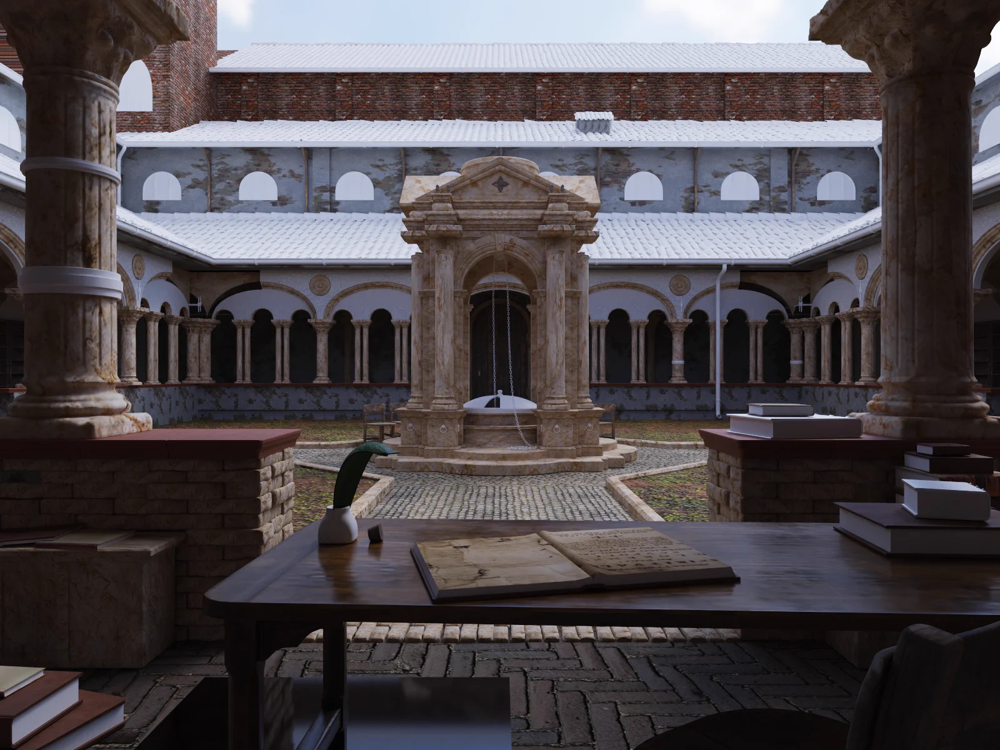

# Crucible 專案解析：由 AI 代理駕駛的 3D 引擎



**Crucible**（[codepawl/crucible](https://github.com/codepawl/crucible)，MIT 授權）是一句宣言式定位的 3D 引擎：

> **Crucible is a 3D engine for JavaScript that an AI agent drives through an MCP server. It makes 3D easy to understand and easy to do.**

它的前身是 **67js**（npm 套件 `@codepawlhq/67js` 已棄用，改裝 `@codepawlhq/crucible`）。專案 2026-10-08 創建，截至本文撰寫日（2026-11-16，星數經 GitHub API 驗證）已累積 **683 顆星**、54 個 fork，發佈節奏約每周一個 minor 版——上線五週已推到 **v0.20.0**（11-14 發佈），當天仍有新的 commit，開發極為活躍。

它的野心寫在 [docs/goal.md](https://github.com/codepawl/crucible/blob/main/docs/goal.md) 裡，三個可驗證的目標：

1. **像 Blender 一樣強**——每項能力都要有對照基準的證據（golden fixture 或參考渲染），示範/demo 不算數。
2. **像 three.js 一樣輕**——同一場景在位元組與執行期都要比 three.js 便宜，每個場景有 PR 不可逾越的體積預算。
3. **對 AI 盡可能友善**——冷啟動的代理在相同任務上，要比操作官方 Blender MCP 與 three.js 程式碼成功率更高、工具呼叫與 token 更少，而且**永不執行代理生成的程式碼**。

## 核心架構：場景就是純資料

Crucible 沒有節點編輯器、沒有元件系統——**一個場景就是一組資料：每個零件（part）有一份幾何、一個 4x4 矩陣、一個材質**。程式面上是純 ESM 的 JavaScript：

```js
import { CrucibleRenderer, box, sphere } from 'crucible';

const parts = [
  { name: 'Floor', geometry: box(),
    matrix: placed([0, 0, 0], [8, 0.1, 8]),
    material: { color: [0.4, 0.42, 0.45], metallic: 0, roughness: 0.9, emission: 0 } },
  { name: 'Ball', geometry: sphere(48, 24),
    matrix: placed([0, 1, 0]),
    material: { color: [0.8, 0.3, 0.2], metallic: 0, roughness: 0.35, emission: 0 } },
];

const renderer = new CrucibleRenderer(canvas, parts, { samples: 4, memoryBudgetMiB: 256 });
renderer.render({ eye: [4, 3, 6], target: [0, 1, 0] });
```

`updateParts()` 可移動／改色而不重新上傳，`resize()` 與 `dispose()` 管理生命週期。需求僅 Node.js 20.19+；WebGL2 瀏覽器跑柵格化與 WebGL2 路徑追蹤，WebGPU 後端需 WebGPU。

### 四套渲染器

| 名稱 | 是什麼 | 跑在哪 |
|---|---|---|
| **Glaze**（`CrucibleRenderer`） | 即時柵格化器 | WebGL2 |
| **Cook** | 路徑追蹤器，一工作一張靜態圖 | CPU（預設）、WebGL2、Vulkan 光線查詢（選用 `@codepawlhq/cook` 套件）、WebGPU（WGSL compute 軟體 BVH，僅函式庫） |
| 即時路徑追蹤器 | 混合式追蹤 + 輻射度快取 + 時序降噪（實驗性，MCP 未開放） | WebGPU（WebGL2 降級） |
| 光照烘焙 | 烘焙光照圖（lightmap） | CPU、WebGL2、WebGPU |

值得注意的細節：瀏覽器的 WebGPU 沒有硬體光線追蹤，Cook 的 WebGPU 後端是在 WGSL compute 裡自己追 BVH——原生（Vulkan）與 WebGPU 兩條實作的影像差異 FLIP 僅 0.0000–0.0003，等於畫質幾乎相同。

## 代理介面：MCP 伺服器是全案的主角

這是一般 3D 引擎沒有的東西。Crucible 內建 MCP 伺服器，把代理接上**一個常駐的瀏覽器渲染器**：

```sh
npx crucible-mcp --backend gpu --memory 192   # gpu=硬體 WebGL2；cpu=無顯示卡機器
```

代理的工作循環設計得非常「人在迴路」：

- 用 **JSON 場景配方**（agent-scene）作者場景，含修訂與檢查點；匯入 GLB 資產、設定燈光與霧效、加動畫。
- 拿回 **PNG 預覽**，可在 **review grid 一次比較最多四個視角**，再決定方向。
- 對品味問題會**主動提問**（`scene_ask_user`），不擅自決定外觀、不讓人被動等待。
- 交辦 **render jobs** 輸出靜態圖與 MP4——影片逐幀串流，整部片不會吃進記憶體。

安全邊界明確：**MCP 伺服器不接受任意程式碼、不允許遠端資產 URL**。所有工具都是受約束、schema 檢查過的動作——遊戲邏輯也一樣，來自受約束的系統與配方，「代理寫的程式碼在引擎裡跑」被明文列為不做的事。

### 安裝

**最快路：讓代理自己裝。** 把這段貼給 Claude Code / Codex / Cursor / Gemini CLI / OpenCode：

```text
Install Crucible from npm as `crucible@npm:@codepawlhq/crucible` and connect its MCP
server with `npx crucible-mcp`. Read https://crucible.codepawl.com/llms.txt first and follow it.
```

**Claude Code 插件**（一條命令裝好 MCP 伺服器與兩個技能）：

```text
/plugin marketplace add codepawl/crucible
/plugin install crucible@crucible
```

兩個內附技能分工明確：`build-crucible-scene`（場景與材質）、`render-crucible-media`（圖片與影片輸出）。纯文字指南見 [llms.txt](https://crucible.codepawl.com/llms.txt)。



## 外掛生態：從地形到網購級多人遊戲

每個外掛是獨立 import，頁面只載入用到的部分。覆蓋面之廣是「遊戲引擎」級別：

| 領域 | 重點外掛 |
|---|---|
| 光照 | HDRI 影像基礎光照 |
| 地形／植被 | 分塊地形、掃描地表圖層；樹木、草、地面雜物（含風與 LOD） |
| 角色 | glTF 匯入、動作片段 retarget、IK 姿態層、動畫圖（狀態機、1D/2D 混合空間、遮罩層） |
| 液體／車輛 | 烘焙液體播放（折射＋飛沫）、沿路徑的輪式車輛 |
| 物理 | Rapier 接触與關節錄入時間軸；即時物理世界（Rapier 或選用 Jolt），接触／射線／重疊查詢 |
| 即時遊戲 | 遊戲迴圈、輸入（鍵盤／滑鼠／手把／觸控／重播）、串流載入（位元組預算＋LRU＋LOD 遲滯）、**網路碼**（主從權威、快照增量、客戶端預測與校正）、空間音訊、玩家控制器與攝影機rig、JSON 遊戲規則文件 |
| 建模 | 網格編輯、建模工具、雕刻筆刷 |
| 離線輸出 | 路徑追蹤靜態圖、光照烘焙、自訂全螢幕 GLSL 後製通道 |
| 代理 | 場景工作階段（修訂與檢查點）、資產匯入 |

官方文件頁與 3D 展示（[showcase](https://crucible.codepawl.com/showcase.html)）列出所有指南；瀏覽器裡直接開場景，不需安裝。

## 公開的效能基準：敢和 Cycles 擺在同一張表

Crucible 的基準測算是罕見地透明：方法、機型、限制條件全部公開。測試機為 RTX 3060 12GB + i7-14700KF、Chrome 157 headless、Blender 5.3，量測日 2026-11-11。摘錄關鍵數字：

**體積**：`lit-box` 場景 Crucible **58,788 bytes gzip**，three.js 133,797 bytes——**小 2.28 倍**（目標 50KB 尚未達成，體積預算由 CI 把關）。

**即時層（Glaze）**：960x540 六個場景，每幀 0.77–0.98 ms（含讀像素），排隊連發 0.35–0.50 ms。對照 EEVEE 5.3 一次完整背景渲染呼叫（64 取樣）是 288–363 ms——注意這是「渲染呼叫」不是幀率對比。

**終層（Cook vs Cycles OptiX）**：Cook 原生每取樣比 Cycles 快 **3.8–6.2 倍**，但同雜訊下需要更多取樣（噪聲受限場景要 Cycles 的 6.6–19 倍取樣數），折算**同誤差總時間約 Cycles 的 0.87–2.52 倍**。FLIP 誤差（對 Cycles 4096 取樣參考圖）：Cook 原生 0.019–0.080、Cycles 0.010–0.039。金屬、玻璃、戶外 HDRI 場景 Cook 尚未追平 Cycles（1/N 衰減偏慢、疑似偏差），README 直白承認，不給美化數字。

**實驗性即時路徑追蹤**：WebGPU 後端每幀 5.6 ms；FLIP 16 幀（0.15 秒）後降到 0.20 以下、64 幀（0.41 秒）降到 0.10 以下、256 幀收斂於 0.056。WebGL2 降級版每幀 6.7 ms（首幀 6.1 秒含著色編譯）。


*基準場景之一：Blender Cycles 參考渲染（上）與 Crucible 渲染（下）並置於 repo 的 default-look 對比組。*



## 設計哲學：Show, then tell

goal.md 的三條鐵律解釋了為什麼這個專案的文件長這樣：

1. **先給看，再講解**——README、文件、changelog、release notes 一律以 Crucible 自己渲染的圖與短片開場；看得見的變更必附圖或短片。
2. **白話**——文字先講「你能做出什麼、代理替你做了什麼」，程式碼放後面。
3. **人留在迴路**——代理工具回傳預覽與選項供你反應；品味問題由人拍板。

**明文不做**：滑鼠編輯器與 Blender 介面、影片剪輯器、動作追蹤、Grease Pencil、讀 `.blend` 檔、相容 Blender Python API（**GLB 是交換格式**）、在引擎內執行代理寫的程式碼。每項都在 parity ledger 有記載原因。



## 適用場景

- **讓代理生成 3D 場景與短片**：貼一段 prompt 就得到「場景→預覽→審查→輸出 PNG/MP4」的完整流水線，比讓代理直接寫 three.js 少了執行任意程式碼的風險與除錯輪次。
- **瀏覽器端的輕量遊戲／互動應用**：遊戲迴圈、物理、輸入、網路碼、空間音訊全有外掛，且 bundle 比 three.js 小一半以上。
- **需要離線級畫質但不想開 Blender**：Cook 路徑追蹤在 CPU／WebGL2／Vulkan／WebGPU 都能跑，同誤差下與 Cycles 同數量級，逐幀串流輸出影片。

## 生態與現況

- 每週一個 minor；1.0 之前 minor 可破壞 API，一切陳列於 [CHANGELOG.md](https://github.com/codepawl/crucible/blob/main/CHANGELOG.md)。
- 下游應用：[viz3d](https://github.com/codepawl/viz3d) 技能把地點、系統與事件變成 3D 應用與影片，渲染端就是 Crucible。
- 維護模式：`AGENTS.md` 供編碼代理起手，`npm run preflight` 本地跑 PR 檢查，CI 每次 PR 都在 bun 下跑封裝好的 MCP 伺服器——是一個「以代理開發代理工具」的自我餵食專案。
- 開放議題 73 個，里程碑以 `0 Measure → 6 Games` 分組，每張 issue 掛 `goal:capable / goal:light / goal:ai` 標籤，與三大目標一一對應。

以 683 星的体量說，Crucible 是目前「代理原生 3D」方向上文件、基準與邊界定義得最完整的開源嘗試——它不一定已經打平 Blender，但它把「打平與否如何驗證」這件事先做成了公開帳本。與上週榜上的 [agent-browser](/github-trending-top11/)（瀏覽器自動化 CLI）互為印證：代理的工具層正被逐個重寫成「受約束、可驗證、回傳預覽」的介面，3D 是其中最新的一塊領地。

## 方法說明

資料來源：[GitHub 倉庫](https://github.com/codepawl/crucible) 之 README、docs/goal.md、docs/cycles-parity.md 索引、CHANGELOG 與 releases；星數與中繼資料以 GitHub API 於 2026-11-16 驗證；配圖下載自官方倉庫與官網並存於本站 `/assets/images/crucible/`。
