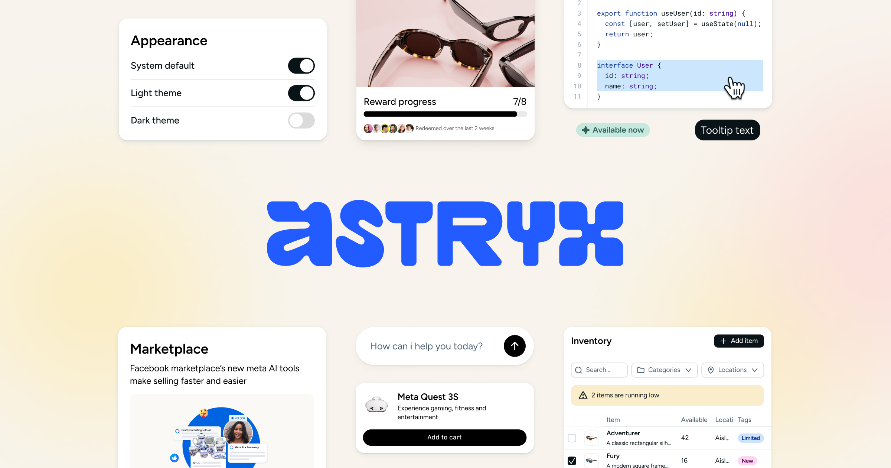
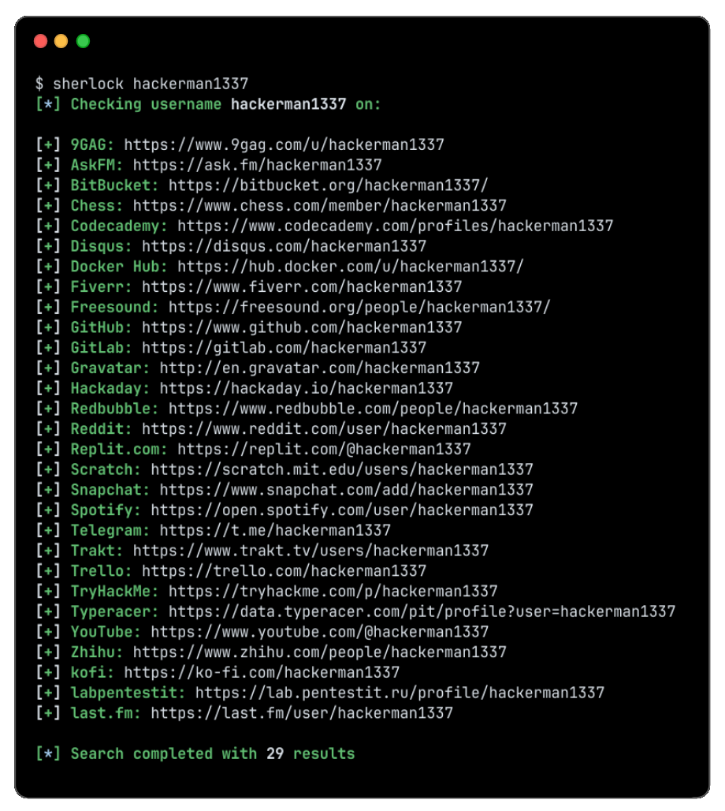
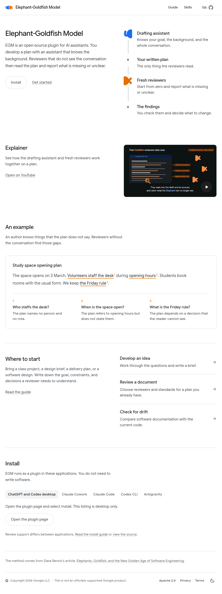
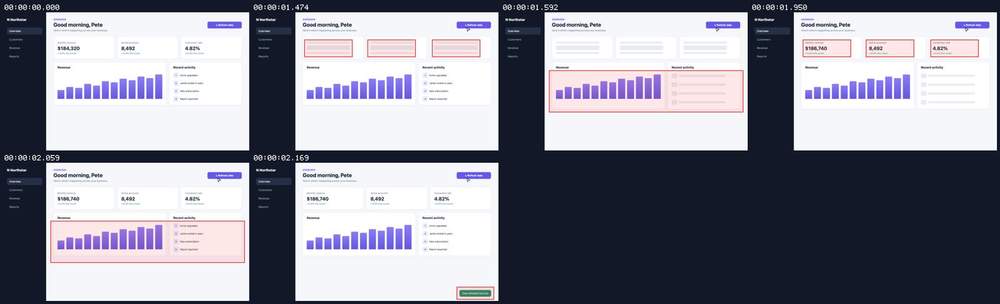
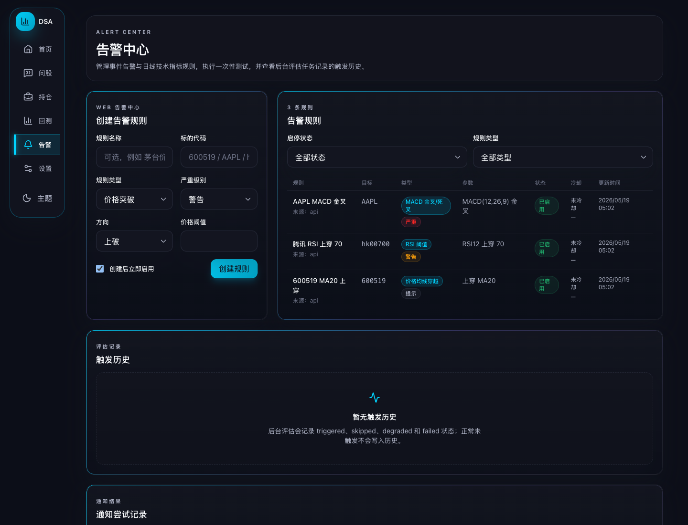
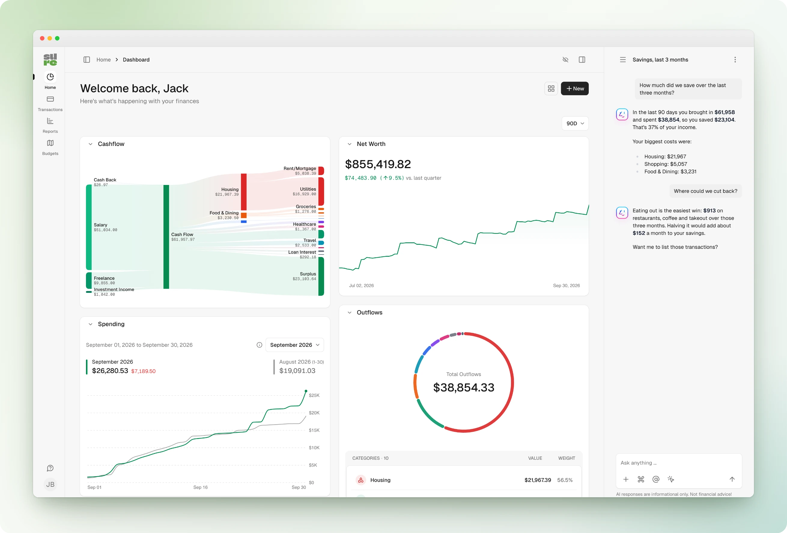
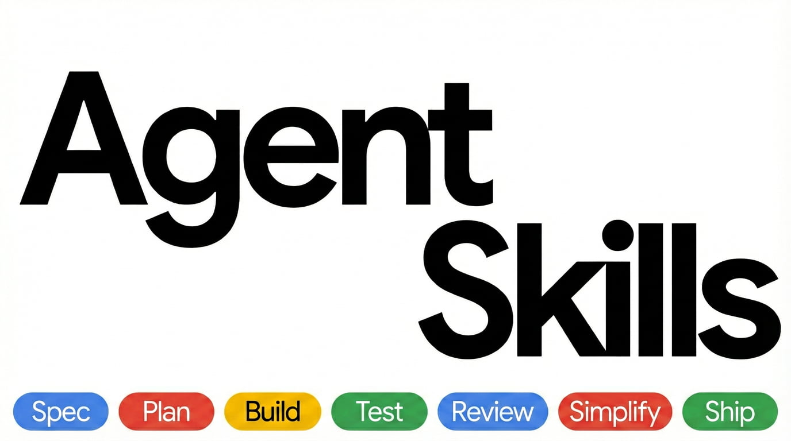
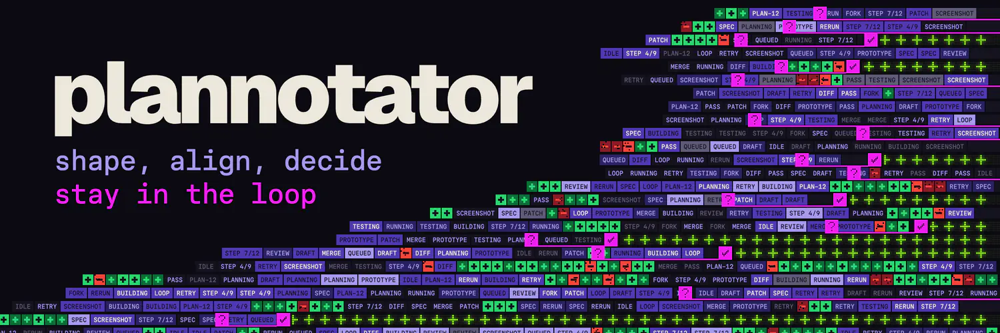
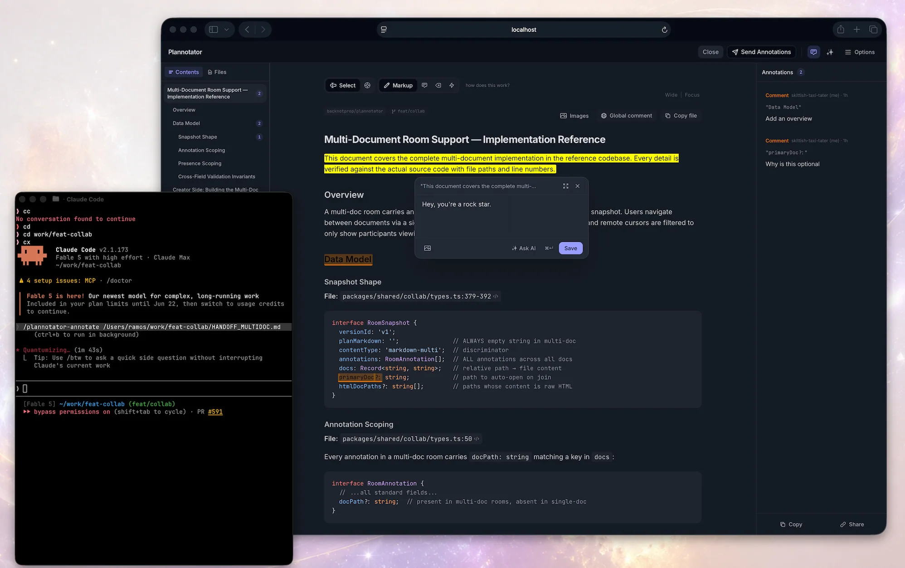

# 本週 GitHub 熱門項目整理（2026-11-16）

資料來源：[GitHub Trending（本週）](https://github.com/trending?since=weekly)。本週榜單共 11 個專案，全部收錄；總星數直接取自趨勢頁並以 GitHub API 逐一核對（例：Sherlock API 回報 112,467 與榜單一致），依「本週新增星數」降序排列。

**一句話本週主題**：Agent Skills 生態全面開花——榜上近半專案在教 AI 代理「怎麼做事」而非「做什麼事」，Meta 與 Google 雙雙入場，而「審查層」（review layer）正在成為新的兵家必爭之地。

## 一覽表

| 排名 | 專案 | 語言 | 總星數 | 本週新增 | 主題 |
|---:|---|---|---:|---:|---|
| 1 | [meta/astryx](https://github.com/meta/astryx) | TypeScript | 28,836 | +13,660 | 設計系統 |
| 2 | [sherlock-project/sherlock](https://github.com/sherlock-project/sherlock) | Python | 112,467 | +12,401 | OSINT 工具 |
| 3 | [milind-soni/OpenMausBot](https://github.com/milind-soni/OpenMausBot) | TypeScript | 23,362 | +6,413 | AI 代理聊天桌面端 |
| 4 | [anthropics/skills](https://github.com/anthropics/skills) | Python | 195,344 | +6,220 | Agent Skills 官方庫 |
| 5 | [google/elephant-goldfish-model](https://github.com/google/elephant-goldfish-model) | Python | 19,737 | +5,539 | 設計/審查插件 |
| 6 | [vercel-labs/agent-browser](https://github.com/vercel-labs/agent-browser) | Rust | 51,603 | +4,601 | 瀏覽器自動化 CLI |
| 7 | [ZhuLinsen/daily_stock_analysis](https://github.com/ZhuLinsen/daily_stock_analysis) | Python | 72,497 | +4,526 | LLM 股票分析 |
| 8 | [we-promise/sure](https://github.com/we-promise/sure) | Ruby | 15,698 | +4,483 | 個人理財 |
| 9 | [addyosmani/agent-skills](https://github.com/addyosmani/agent-skills) | JavaScript | 117,935 | +3,670 | 工程技能庫 |
| 10 | [google-deepmind/mujoco](https://github.com/google-deepmind/mujoco) | C++ | 18,068 | +1,859 | 物理模擬引擎 |
| 11 | [backnotprop/plannotator](https://github.com/backnotprop/plannotator) | TypeScript | 11,817 | +818 | 代理審查工作區 |

（上期整理見 [本週 GitHub 熱門項目](/github-trending-weekly/)。）

---

## 第 1 名：meta/astryx — Meta 把用了八年的內部設計系統整個開源

**功能說明**：Astryx 是 Meta 內部孵化八年、支撐 **13,000+ 個內部應用**的最大設計系統，目前以 Beta 身分開源（MIT）。技術棧為 React 19+ 與 StyleX，交付 150+ 個無障礙元件、品牌層級主題、深色模式、成套模板與一個 CLI。使用上是「預編譯 CSS + 型別化 React 元件」，**不需要 build 插件、不需要採用特定樣式庫**；安裝為 `@astryxdesign/core`（npm）。三個差異化賣點：內部結構全開放（元件可自由組合，需要更深控制時用 `swizzle` 把元件原始碼直接 eject 進專案）；樣式零綁定（可直接用 Tailwind、CSS Modules 或純 CSS 以 `className` 覆蓋）；主題即資料（一組 token 就是一個主題）。README 標榜「agent ready」——人與 AI 助手用同一套工具組建介面。

**適用場景**：
- 新建 React 專案、不想自己從零打造元件庫與設計 token
- 已有 Tailwind/CSS Modules 專案，需要一套可無縫接入的元件系統
- 團隊大量使用 AI 程式碼代理，需要結構化、可被代理理解的設計系統

## 第 2 名：sherlock-project/sherlock — OSINT 老牌工具單週再漲 1.2 萬星

**功能說明**：Sherlock 用一個使用者名稱橫掃 **400+ 個社群網路**，找出該帳號的註冊足跡，是 OSINT（開放情報）領域的標準工具。安裝管道齊全：`pipx install sherlock-project`、Docker（`docker run -it --rm sherlock/sherlock`）、dnf，社群亦維護 Debian/Ubuntu/Homebrew/Kali 套件（官方提醒 ParrotOS 與 Ubuntu 24.04 的第三方套件已損壞，請改用 uv/pipx/pip 或 Docker）。用法極簡：`sherlock user123` 可一次查多個名稱，命中結果寫入以帳號命名的文字檔。

**適用場景**：
- 調查特定帳號的跨平台足跡（人肉搜尋、盡職調查）
- 品牌保護：檢查公司名稱/創辦人姓名是否被搶注
- 資安研究：攻擊面情報收集與個資外洩排查

> ⚠️ 解讀保留：Sherlock 總星數已達 11.2 萬，本週再 +12,401 屬老牌專案的異常爆發曲線，榜單熱度不等於實際新增採樣，星數可能摻有異常流量。

## 第 3 名：milind-soni/OpenMausBot — 開源的 Grok Bot 替代品：把 AI 代理組成名為「聯絡人」的團隊

**功能說明**：OpenMausBot（前身 OpenGrokBot）是一個 Electron 桌面應用（macOS/Windows/Ubuntu，TypeScript 嚴格模式 + React 19），定位為 Grok Bot、Meta Muse、OpenAI dots 與 Cue by Manus 的開源替代。核心概念：側欄裡每個「聯絡人」都是一個真實代理——本機執行的 Claude 或 Codex——各自有個性、模型、自己的雲端電腦與已連線應用。像傳訊息一樣跟他們對話、旁觀他們工作、只對重要動作按批准。採 bring-your-own-agent、local-first：模型用你手上現成的。官方提供 Mac（Apple silicon/Intel）與 Windows 安裝檔。

**適用場景**：
- 想在一個聊天介面裡同時指揮多個本機編碼代理
- 需要「代理有持久身分與工具連線」而非每次開新交談
- 在意資料不出本機、模型自選的團隊

## 第 4 名：anthropics/skills — Anthropic 官方 Agent Skills 倉庫

**功能說明**：這是 Claude 官方技能實作的公開倉庫（Apache 2.0）。Skills 是「指示 + 腳本 + 資源」資料夾，Claude 會依任務動態載入，讓它以可重複的方式完成專門工作。倉庫收錄從創意應用（美術、音樂、設計）、技術任務（測試 web 應用、產生 MCP 伺服器）到企業工作流程（溝通、品牌規範）的示範技能，每個技能以 `SKILL.md` 自帶指示與中繼資料。亮點是連 Claude 生產環境的**文件建立/編輯核心技能**——`docx`、`pdf`、`pptx`、`xlsx` 四個子資料夾——也一併開源，作為「真實上線複雜技能」的參考實作。Agent Skills 標準規範另見 agentskills.io。

**適用場景**：
- 想寫自訂技能、先讀官方範例與生產級參考實作
- 需要讓代理生成/處理 Office 文件與 PDF
- 追蹤 Agent Skills 標準生態的演進

## 第 5 名：google/elephant-goldfish-model — 用大象設計、用金魚審查

**功能說明**：EGM 是 Google 開源的 AI 助手插件，口号「Develop ideas with context and review documents with fresh eyes」。設計哲學是把角色拆開：**Elephant** 持有專案完整脈絡、起草規格文件；**Goldfish** 審查者在**不含先前對話**的全新脈絡中檢視草稿與引用的原始資料，专门暴露未被說出口的假設與盲點；最終的架構取捨由你拍板。內建「草稿 → 設計審查」工作流以軟體規格為目標，`/egm-review-loop` 可為其他文件自選審查者與標準，另附 bootstrap 與設計漂移（drift）回報。安裝覆蓋全家桶：ChatGPT/Codex 桌面版插件、Antigravity CLI、Claude Code（`claude plugin marketplace add google/elephant-goldfish-model`）、Codex CLI。對既有文件跑一次 60 秒審查不需先寫新規格。

**適用場景**：
- 規格/設計文件定稿前的獨立第三方審查
- 對照實際程式碼審查 README、PR 計畫
- 想體驗 Google 官方對「代理協作設計流程」的参考答案

## 第 6 名：vercel-labs/agent-browser — 給 AI 代理用的瀏覽器自動化 CLI

**功能說明**：Vercel Labs 的原生 Rust CLI（Apache-2.0），讓代理一次一個 shell 指令-driving 瀏覽器。核心循環：`agent-browser snapshot -i` 把頁面輸出為緊湊文字、每個互動元素附 `@e1` 參考記號 → `agent-browser click @e1` 動作 → `get url` 驗證結果 → 重複。瀏覽器在指令之間保持開啟，每步只是一次短 shell 呼叫，對代理的 context 極友善。安裝：`npm install -g agent-browser`（首次 `agent-browser install` 下載 Chrome for Testing）、Homebrew、或免安裝 `npx agent-browser open example.com`；Linux 加 `--with-deps` 一併裝系統函式庫。也支援 CSS 選擇器、文字、XPath 與語意定位。

**適用場景**：
- 在 terminal/agent 環境裡需要驅動真實瀏覽器（登入、表單、點擊）
- 替代理設計瀏覽器工具：文字快照 + ref 比截圖省 token
- 網頁流程的輕量自動化與驗證

## 第 7 名：ZhuLinsen/daily_stock_analysis — LLM 驅動的多市場自選股分析系統

**功能說明**：基於 LLM 的自選股智能分析系統，覆蓋 A 股、港股、美股、日股、韓股、台股：多源行情串接、即時新聞整合，每日自動產出「決策儀表板」並推送到企業微信、飛書、Telegram、Discord、Slack 或信箱。主打**零成本定時運行**——掛 GitHub Actions 即可排程，亦提供 Docker 映像（`zhulinsen/daily_stock_analysis`）。README 有簡中/英/繁中三語文件，並附 arXiv 技術報告（2608.26990）。

**適用場景**：
- 盤後自動彙整自選股訊號並推播到即時通訊工具
- 想用 LLM 做新聞＋行情的綜合摘要，而不是自己逐個看盤
- 免伺服器方案：全部跑在 GitHub Actions 排程上

## 第 8 名：we-promise/sure — 停運理財巨頭 Maybe 的社群分身

**功能說明**：Sure 是自託管個人理財與淨值追蹤應用（Ruby on Rails），是**已停止維護的 Maybe Finance 的社群 fork**——原團隊花掉近 100 萬美元開發、2023 年中停業後開源並歸檔，社群接手繼續推。功能覆蓋現金流、淨值、支出與資金流出面板，並內建 AI 助手回答儲蓄與財務問題。README 提供多語翻譯入口，社群以 Discord 為中心運作。

**適用場景**：
- 想要自託管版 Copilot Money/YNAB：資料留在自己伺服器
- 接手 Maybe 舊部署、需要一個持續維護的分身
- 重視「由所有人為所有人」的開源治理模式

## 第 9 名：addyosmani/agent-skills — 把資深工程師的開發紀律打包給 AI 代理

**功能說明**：Chrome 團隊工程領袖 Addy Osmani 的「生產級工程技能」庫：把工作流、品質閘門與最佳實踐打包成技能，讓 AI 編碼代理在開發全週期一致地遵循。9 個斜線命令對應DEFINE→PLAN→BUILD→VERIFY→REVIEW→SHIP 生命週期：`/spec`（先規格後程式碼）、`/plan`（小而原子的任務）、`/build`（一次一個切片）、`/test`（測試即證明）、`/constraints`（品質線定一次、處處執行）、`/review`、`/webperf`（先量測再優化）、`/code-simplify`（清晰勝過取巧）、`/ship`。`/build auto` 在批准計畫後一次自主實作全部任務——每個任務仍是測試驅動、逐個 commit，失敗或高風險步驟會暫停等人。技能依動作自動激活：設計 API 觸發 `api-and-interface-design`、做 UI 觸發 `frontend-ui-engineering`。

**適用場景**：
- 嫌 AI 生成的程式碼「能跑但沒紀律」，要導入工程品質閘門
- 想建立「spec → plan → build → test → ship」的代理開發流水線
- 在 Claude Code 等工具找可直接安裝的成熟技能包

## 第 10 名：google-deepmind/mujoco — 機器人學習的標準物理引擎

**功能說明**：MuJoCo（**Mu**lti-**Jo**int dynamics with **Co**ntact）是 Google DeepMind 維護的通用物理引擎，服務於機器人、生物力學、圖形動畫、機器學習等需要快速且精確模擬關節結構與環境互動的領域。C API、為研究者調校過的運行時模擬模組（低層資料結構 + 內建 XML 編譯器預先配置），內含桌面視窗與瀏覽器內的互動視覺化，並提供 Python 綁定與 Unity 插件。零安裝上手：mujoco.org 瀏覽器版、live.mujoco.org 的 WebAssembly 版 MuJoCo Studio 可直接拖放自己的模型。

**適用場景**：
- 機器人控制/強化学習的模擬環境基底
- 生物力學（人物動作、肌腱骨骼）模擬
- 遊戲與動畫需要高精度接觸動力學

## 第 11 名：backnotprop/plannotator — 代理時代的「審查收件匣」

**功能說明**：Plannotator 是本地端、瀏覽器基礎的代理審查界面：對計畫、規格、Markdown、HTML 與其他互動產物做視覺化註解，審查 diff 與 PR，再把回饋送回給你的代理——「shape, decide, plan, review, stay in the loop」。支援幾乎全部主流編碼代理：Claude Code、Codex、Copilot CLI、Gemini CLI、OpenCode、Kiro、Droid、Amp、DeepSeek 等。新推出的 **Plannotator Inbox** 定位為多代理工作與你之間缺少的審查層：集中浮現決策、原型、變體與計畫；另有終端機版 Herdr Annotate 與視覺化 HTML 技能庫。

**適用場景**：
- 代理產出長計畫/規格時，用圈選註解取代純文字回饋
- 多代理並行工作時需要統一的審閱收件匣
- 對代理生成的 HTML 產物做視覺化 code review

---

## 本週觀察

1. **「技能」是今年最熱的賽道**：榜上 11 個專案有 4 個直接做 Agent Skills（Anthropic 官方庫、Addy Osmani 工程技能、EGM、Plannotator），連 Meta 的 Astryx 都以「agent ready」為賣點。競爭焦點要從「哪個模型強」轉到「誰定義了代理的做事方法」。
2. **大廠罕見地集體開源工具鏈**：Meta（Astryx）、Google（EGM、MuJoCo）、Anthropic（skills）、Vercel（agent-browser）同週上榜——代理基礎設施已成門戶級投入，而且全數是可直接安裝的成品，不是論文。
3. **「審查層」正在成形**：EGM 的金魚視角審查、Plannotator 的收件匣、OpenMausBot 的「批准重要動作」，共同指向同一個缺口——代理產出越多，人類需要的審閱界面就越專業化。
4. **熱度曲線要打折解讀**：Sherlock 11.2 萬星的老牌專案單週 +12,401、OpenMausBot 上線未久即單週 +6,413（約總數的 27%），兩者曲線均屬異常爆發，榜單排名與實際採樣增長之間保留解讀空間。
5. **非 AI 基礎建設仍有位置**：MuJoCo（物理引擎）與 Sure（自託管理財）提醒：資料、物理、錢包這些「實體世界」的基礎設施，在代理熱潮裡照樣有人買單。

## 方法說明

- 榜單與星數：解析 [GitHub Trending?since=weekly](https://github.com/trending?since=weekly) 原始 HTML（2026-11-16 抓取），總星數以 GitHub API（`/repos/{owner}/{repo}`）抽樣核對一致。
- 排序：依「本週新增星數」降序。
- 專案介紹：整理自各倉庫 README 與官方文件；配圖下載自官方倉庫/官網並存放於本站 `/assets/images/` 路徑。
- 上期週報：[本週 GitHub 熱門項目](/github-trending-weekly/)。
