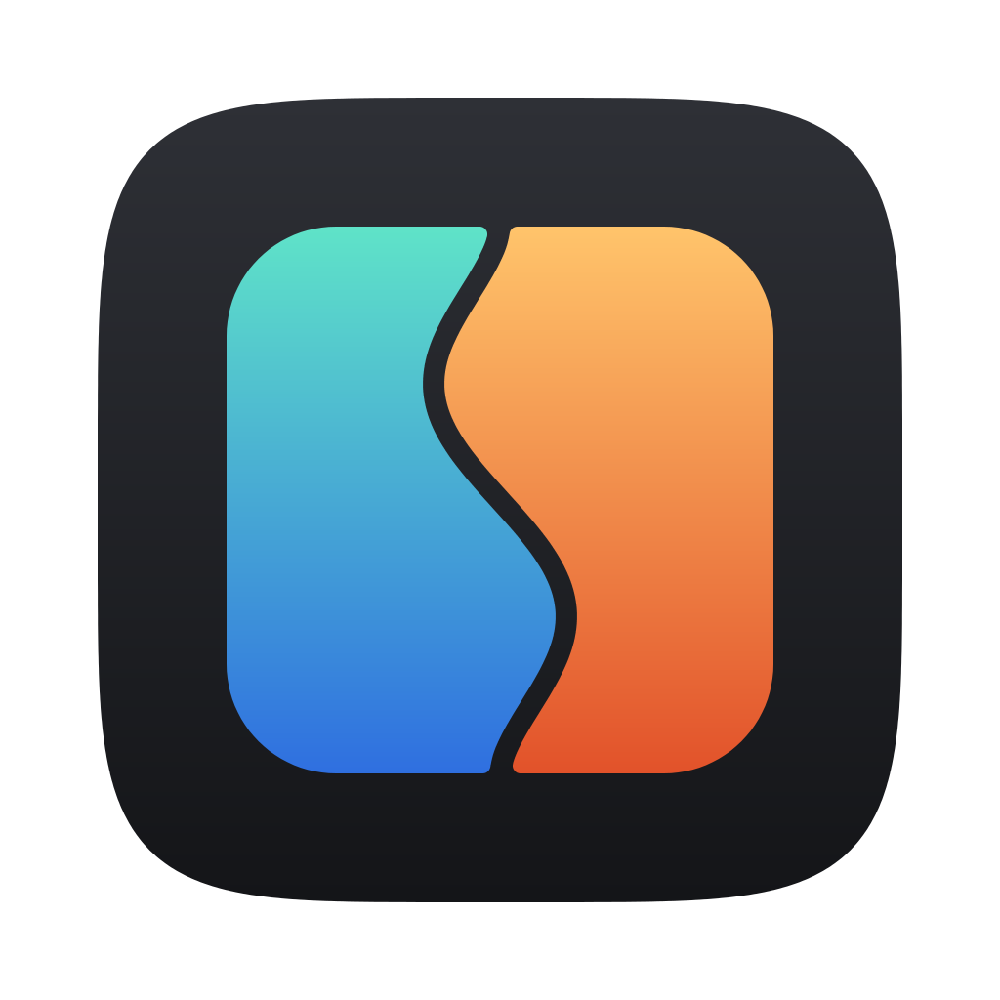

# Stela 專案解析：在 x86-64 PC 上跑 macOS 的反向 Asahi

**Stela**（[tylertms/Stela](https://github.com/tylertms/Stela)，GPL-2.0-or-later）的一句話自述：

> **A translation-based Apple Silicon layer for x86-64 PCs.** — It is a UEFI boot program with an arm64-to-x86-64 translator, a Metal driver for NVIDIA GPUs and a model of Apple silicon hardware. Stela currently presents itself as an M2 Mac mini.

方向與 Asahi Linux 恰好相反：Asahi 是「在 Apple Silicon 上跑 Linux」，Stela 是「**在 x86-64 PC 上模擬 Apple Silicon、讓 macOS 的 arm64e 程式碼跑起來**」。開機時，Stela 的 `stela.efi` 對韌體與作業系統端呈現一台 M2 Mac mini 的硬體形象。

專案 2026-10-12 創建，至本文撰寫日（2026-11-16，星數經 GitHub API 驗證）五週累積 **2,645 顆星**、168 個 fork、61 個開放議題。發佈節奏兇猛：v0.3.0 與 v0.3.1 同在 11-12，v0.4.0 與 v0.4.1 同在 11-14，**v0.4.2 於 11-15 推出**，當天 main 分支仍有八筆以上的 commit。貢獻者幾乎是單人專案——作者 tylertms 一人就提交 **7,418 個 commit**。

官方自己掛著警告：**仍在開發中、很慢、在支援的硬體上甚至可能開不了機**。

## 三大元件

### 1. 翻譯器：arm64e → x86-64

* 採**先驅翻譯（ahead-of-time）與即時編譯（JIT）雙軌**，把 arm64e 指令翻成 x86-64。
* 已涵蓋 **3,000 條以上 AArch64 指令編碼**，做**來賓暫存器到宿主暫存器的對應**，並快取已翻譯的碼。
* 工作區 crate 分工清晰：`stela-compiler`（「ARM64 碼到 x86-64 的先驅翻譯」）、`stela-engine`（「已翻譯碼的執行：碼快取、派發、來賓記憶體與系統狀態」）、`stela-runtime`、`stela-crypto`、`stela-tls`。近期 commit 全在死磕翻譯器的轉移快取、PAC 分支預測、區塊鏈接等執行期細節——這是純體力的翻譯器工程。

### 2. Metal 驅動：給 NVIDIA GPU

* 把 **AIR（Metal 的著色器 IR）直接編譯成 NIR（Mesa 的 IR）**，支援 **Metal3 與 Apple7 兩個 GPU 家族**。
* 等於把 macOS 的 Metal 呼叫接到 Mesa/NVIDIA 的開源管線上；宿主端有 `stela-mesa`、`stela-driver-gpu` 等驅動 crate，來賓端（跑起來的 macOS 裡）則裝 `StelaGPU.kext` 與對應 bundle。
* 這就是它只支援 NVIDIA GeForce **GTX 16 / RTX 20、30、40、50 系列**的原因。

### 3. Apple Silicon 硬體模型

* `stela-soc` 是「**Apple M2（T8112）裝置的暫存器級模型**」，`stela-soc-data` 提供資料表；對 macOS 來說，眼前的主機就是一台 M2 Mac mini。
* 開機由 `stela-boot`（UEFI 開機程式）扛起，裝載、格式、安全（`stela-loader`、`stela-formats`、`stela-fingerprint`）各有 crate。

### 第三方來源全用 submodule

`third_party/` 掛著五個 shallow submodule：**gregkh/linux、Mesa、LLVM、libdrm、Apple 官方開源發行版 xnu**（作參考規格）。首次編譯會抓下並編譯 Linux、Mesa 與 LLVM 原始碼，官方直言「會花很長的時間」。倉庫自述 **不含任何 Apple 軟體**，xnu 是 Apple 依開放源碼授權釋出的公開碼。

## 硬體需求

| 項目 | 需求 |
|---|---|
| CPU | Intel/AMD x86-64-v2（Nehalem、Bulldozer 之後），有 AVX2／AVX-512 就加速 |
| 記憶體 | 8 GB 以上 |
| 韌體 | 64 位元 UEFI，**關閉 Secure Boot** |
| GPU | NVIDIA GeForce GTX 16 或 RTX 20/30/40/50 |
| 磁碟 | NVMe 或 AHCI 模式的 SATA；要裝 macOS 需 60 GB 以上（GPT 分割或整顆抹除） |
| USB 隨身碟 | 線上安裝器 8 GB／離線安裝器 32 GB |
| 有線網路 | Intel（I225/I226/I210/I211/I350/82574L 等）、Realtek（RTL8111/8168/8125…）、Broadcom、Aquantia、Killer 等長清單 |
| Wi-Fi／藍牙／音效 | **目前全無支援** |
| 輸入 | USB 鍵盤滑鼠；PS/2 鍵盤滑鼠與 Synaptics/Elantech 觸控板 |

## 安裝流程

1. 從 [releases 頁](https://github.com/tylertms/Stela/releases) 下載對應平台的 `stela`（Linux／macOS universal／Windows 都有，附 SHA256SUMS 與來源包）。
2. Linux/macOS 執行 `sudo ./stela`；Windows 以管理員身分雙擊 `stela.exe`。
3. 選擇 USB 隨身碟與安裝器（線上／離線），確認後**抹除整顆隨身碟**。
4. 從該 USB 開機。更新是 `sudo ./stela update`，開機日誌用 `sudo ./stela log --output log.txt` 匯出附到 GitHub Issue。
5. macOS 上未公證（notarize），被 Gatekeeper 擋下時先跑 `xattr -d com.apple.quarantine stela`。

開發自建則需要 Rust、git、Python 3.10+、LLVM 21/22/23（含 Clang、LLD、libclang；macOS 端 Apple clang 21+ 亦可），`cargo xtask dist` 一次產出 `target/release/stela`。

## 授權與法律邊界（作者寫得很清楚）

* Stela 自有碼為 **GPL-2.0-or-later**；含 Linux 核心碼的 `stela.efi` 為 GPL-2.0-only，串上 Apache-2.0 crate 的 CLI 為 GPL-3.0-or-later，`Stela.app`／`StelaGPU.kext` 為 GPL-2.0-or-later——每個產物的授權逐條列在 NOTICE。
* **「Stela 不含任何 Apple 軟體」**；使用者自己要為遵守 Apple 軟體授權條款與使用條款負責。macOS 的安裝介质與授權合規性完全在使用者端。

## 與其他方案的座標對照

| 方案 | 方向 | 手段 |
|---|---|---|
| **Asahi Linux** | Apple Silicon 硬體 → 跑 Linux | 為 Apple 晶片寫驅動 |
| **Whisky / CrossOver** | macOS 上跑 Windows 程式 | Wine／Game Porting Toolkit |
| **classic 黑苹果** | x86 PC → 跑 macOS (x86_64) | 補驅動、騙過檢查 |
| **Stela** | x86 PC → **跑 arm64e 的 macOS 世界** | UEFI 層翻譯 + 暫存器級 M2 模型 + Metal→NIR |

黑苹果是「同架構補驅動」，Stela 是「跨架構造晶片」——工程量完全不同量級，目前也遠未成熟（作者自述慢、可能無法開機、無 Wi-Fi/音效）。

## 適用場景

- **研究指令集翻譯與虛擬化**：一個現代、活著的 AOT+JIT 翻譯器實作，3,000+ 指令編碼、暫存器對應、快取策略全部公開可讀。
- **關注「PC 跑 macOS」前沿的人**：這是第一個走「完整模擬 Apple Silicon 平台」路線的公開專案，進展以每週兩個 release 的速度推進。
- **Metal/Mesa 編譯管線研究者**：AIR→NIR 的直接編譯與 kext↔宿主驅動的分工，是罕見的公開參考實作。

## 觀察

1. **五週 2,645 星**的爬升速度說明了需求端的熱度——macOS 綁死 Apple 硬體十年的天花板，社群一直在等一個「反向 Asahi」。
2. 專案的**誠實度高**：README 開頭就是「慢、可能開不了機」的警告；授權逐產物拆分；「不含 Apple 軟體」的法律界線畫得乾淨。
3. 風險面要直說：**目前不具生產可用性**（無 Wi-Fi/藍牙/音效、效能未標榜、單人維護、GPL 授權、macOS 授權合規在使用者端）。把它當成一個公開實驗場的進展追蹤，比當成方案清單的一項務實。

## 方法說明

資料來源：[GitHub 倉庫](https://github.com/tylertms/Stela) 之 README、NOTICE、Cargo 工作區與各 crate 自述、releases 與 commits（以 GitHub API 於 2026-11-16 驗證星數、貢獻者與發佈時間）；配圖取官方 icon，星數曲線為 star-history 即時圖表。
