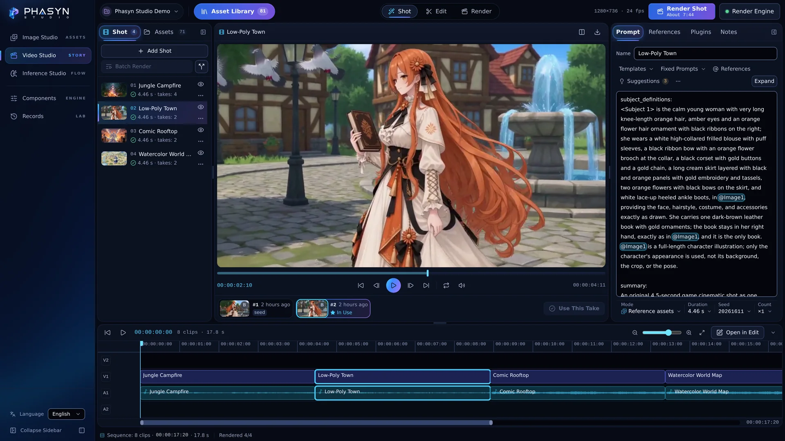
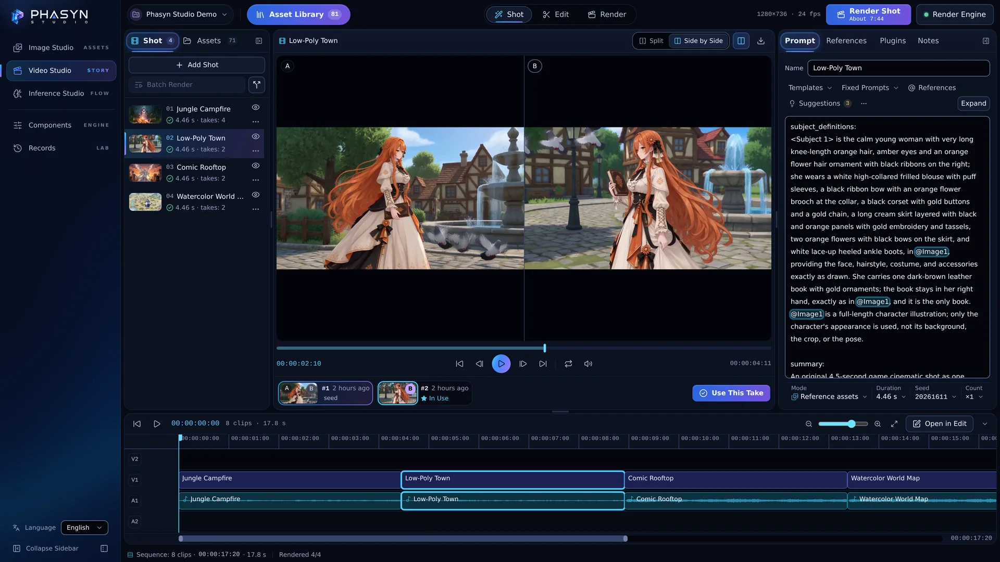
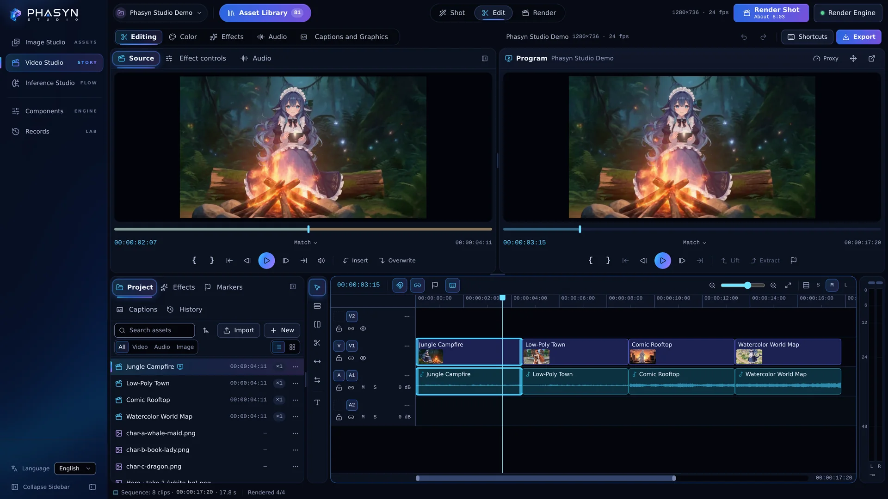
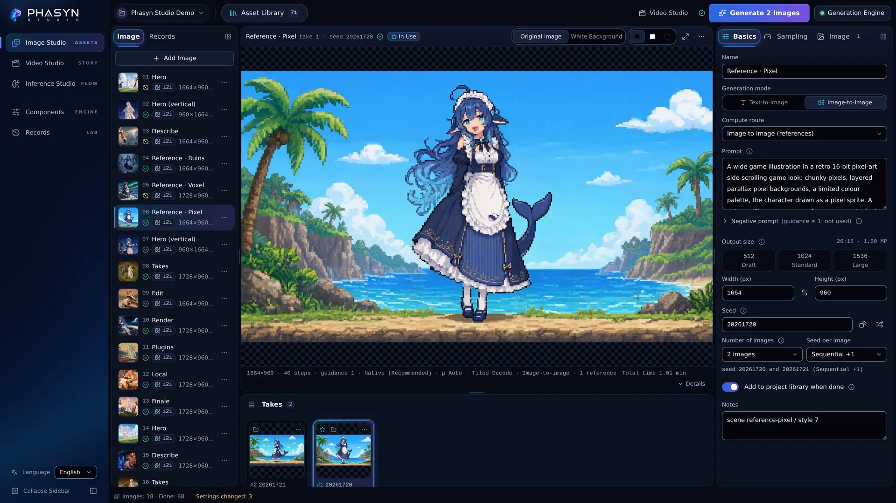

# Phasyn Studio 專案解析：在自己 GPU 上開工的自架 AI 電影工作室



**Phasyn Studio**（[phasyn/phasyn-studio](https://github.com/phasyn/phasyn-studio)，Apache-2.0）的一句話自述：

> **AI filmmaking on your own GPUs** — a self-hosted studio that generates short videos with sound and still images.

這專案**昨天（2026-11-17）才公開**，目前 31 顆星（GitHub API 當日驗證）、0 個開放議題——是一個可以從第一天開始追蹤的新芽。它和「線上 AI 影片服務」的差異在於：**影片生成、圖片生成、剪輯、匯出全部跑在你自己的電腦上**，介面有繁體中文、英文、日文三語。

官方網站：[phasyn.dev](https://phasyn.dev)。

## 可以做什麼：一條完整的短片產線

Phasyn 的抽象單位是**鏡頭（shot）**，整條工作流就是film製作流程的縮影：

1. **鏡頭工作區**：用文字描述一個鏡頭，生成幾個 **take**，從中挑一個。
2. **Take 比較**：同一鏡頭的兩個 take 並排比較後再定案。
3. **自帶素材當參考**：用自己的圖片、影片片段、聲音作為生成條件（reference）。
4. **圖片工作室**：文生圖、圖生圖，為鏡頭做畫面與修改。
5. **剪輯工作區**：像剪輯軟體一樣，在**時間軸**上排鏡頭、修剪、加聲音。
6. **包裝與出品**：加轉場、文字、字幕、音樂，**匯出成影片檔**。



生成端由兩個模型-runtime 撐起：**MiniMax-H3 負責影片**（含聲音）、**Qwen-Image 2.1 負責圖片**，另有 captioner（影像理解）與放大器（upscale）元件。權重一律由使用者自行下載，repo 不含任何模型。

## 架構：Controller＋Node，天生多機

- **Controller**：網頁介面與 API（開 `http://127.0.0.1:8080`）。
- **Node**：每台**有 GPU 的機器**跑一個，負責在該機執行元件（components）。
- 也就是「**單機一條龍、多機可分散**」：Controller 一台、GPU 機器各一台 Node，權重與顯卡分派由部署計畫決定。

程式面是 pnpm＋uv 雙工作區：`apps/frontend`、`packages/`（controller、node、server、media、components、editor-kernel、cli）為 TypeScript；`runtimes/`（h3、qimg、captioner）為 Python 3.12 的 GPU 環境，**每個環境的套件鎖死（pinned）**，文件明文禁止 `uv lock --upgrade` 擅自升級。範例區有 pipelines、components、`generate_dit_components.py` 與 studio-plugins（含深度分層 depth-staging 外掛範例）。

## 安裝：先給你看計畫，才動手

`install.sh` 的設計是這專案最有性格的部分：

```sh
git clone https://github.com/phasyn/phasyn-studio.git
cd phasyn-studio
./install.sh --dry-run    # 只列出計畫，不裝不寫不啟動
./install.sh              # 同意計畫後安裝並啟動全部服務
```

計畫會列出：你的每張 GPU 誰是**主機**（影片與圖片模型）、誰是**副機**（音訊、影像視覺、放大器）；`video / image / vision / upscale` 四條路線群各自啟用與否**及原因**；每個元件落在哪張卡；還缺哪些權重、多大、**各自的授權**；磁碟與記憶體警告。安裝器**從不自己用 sudo**——需要 root 的動作全部印出來讓你自己跑。

## 硬體需求（先量尺寸再入場）

| 項目 | 需求 |
|---|---|
| 作業系統 | Linux（x86_64；aarch64 限統一記憶體 GPU 機器） |
| GPU | NVIDIA，驅動 R580+（CUDA 13.0）。x86_64 離散卡 sm86–sm120；aarch64 sm121（DGX Spark GB10） |
| 實測過 | RTX 3060、RTX 5080、DGX Spark（GB10）；RTX 30/40/50 系列「應該可用但未測」 |
| 模型空間 | 影片約 **200 GB**、圖片 31 GB、影像視覺 8 GB |
| 主機記憶體 | FP8 DiT 常駐約 31 GiB、全預算約 46 GiB；無 FP8 的卡再加約 20 GiB |
| 精度 | FP8 需 compute capability 8.9+；INT8 需 nvcc＋ninja；BF16 全支援 |
| 工具鏈 | uv、Node 22.22+／pnpm 12、Python 3.12、FFmpeg＋ffprobe |

無 GPU 只剩介面。這是一台「吃顯示卡吃磁碟」的重裝備。

## 授權地雷區（README 用整節寫這個，請認真讀）

- 軟體本身 **Apache-2.0**；名稱與標誌不在授權內。
- **MiniMax-H3（影片模型）**：Community License 明文**不得在歐盟、英國、韓國、美國使用或展示**，模型做出的影片也受同樣的地域限制，且**不得用於訓練其他 AI 模型**。
- **Qwen-Image 2.1（圖片模型）**：Qwen Research License，**研究與評測用途（非商業）**。
- 使用自帶素材前確認權利；不得把 AI 生成內容冒充真實或冒充他人。
- 示範角色為社群同人創作，僅作非商業示範。

對照使用者所在地的授權合規完全在自己手上——專案把地雷逐條標好，是難得的誠實作風。

## AI 代理安裝守則：agent-first 的另一個亮點

`docs/agent-install.md` 是一頁**寫給 Claude Code／Codex 看的安裝指南**，規則設計得非常克制，值得抄作業：

- 所有命令走 `--json`，stdout 只有 JSON、進度走 stderr——給機器讀的契約。
- **永不代使用者接受授權**：安裝器列出的每個模型授權要展示、要詢問。
- **永不動自己沒啟動的東西**：端口、systemd 單位被別人佔用時只提議解法，不殺行程。
- 讀狀態只用 `phasyn-studio status --json`（純 GET）；`install`/`up` 有副作用，不可「為了看看而重跑」。
- 不擅自改模板、不升級鎖死的 GPU 環境、不編造設定。

## 適用場景

- **要把 AI 短片產線留在自己機器上**的創作者／工作室：素材不出網、模型選擇與排程自己管，代價是 200GB 級磁碟與高階顯示卡。
- **多 GPU 機器分散部署**：Controller＋Node 架構讓渲染節點可以一台台加。
- **AI 代理操作本地工具鏈的研究與實務**：install plan、JSON CLI、授權守則是一個教科書級的「agent-usable 系統」設計。
- 不適用：手邊沒有 NVIDIA 大顯存機器的人；目標市場落在歐盟/英/韓/美的影片商業產出（MiniMax-H3 授權封死了輸出展示的地域）。

## 觀察

1. **公開第一天**就有完整三語 README、安裝計畫器、代理安裝守則與授權逐條披露——工程紀律遠超星數顯示的水位。
2. 它填的生態位很清楚：ComfyUI 系是「節點圖生成工具」，Runway/Sora 系是「線上服務」，Phasyn 是**自架的『生成＋剪輯＋匯出』成片產線**——時間軸與 take 管理是它區別於生成工具的關鍵詞。
3. 追踪前先看兩件事：**模型授權的地域限制**是否影響你的用途，以及**硬體門檻**（FP8 需 CC 8.9+）對你機隊適配與否。專案極新（0 issues 代表流量還未進來），生產採用建議先蹲幾週 release。





## 方法說明

資料來源：[GitHub 倉庫](https://github.com/phasyn/phasyn-studio) 之 README（英／繁中／日）、INSTALL.md、docs/install.md、docs/agent-install.md、packages 與 runtimes 自述、NOTICE 與 THIRD_PARTY_NOTICES；星數、建立時間與授權以 GitHub API 於 2026-11-17 驗證（建立於当日 09:42 UTC，公開不到一天）；配圖下載自官方 docs/images 並存於本站 `/assets/images/phasyn-studio/`。
