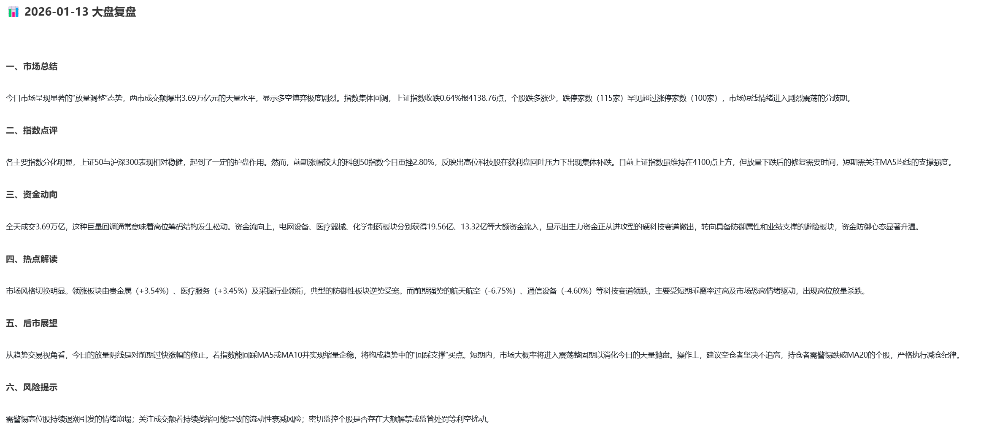
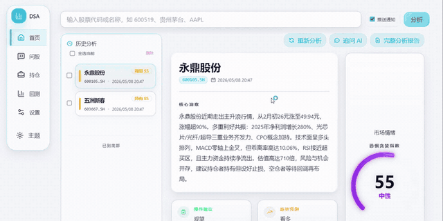
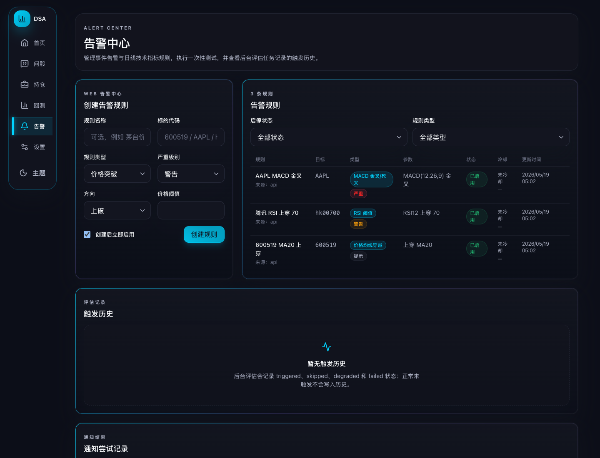

# Daily Stock Analysis 深度解析：零成本掛在 GitHub Actions 的 LLM 自選股決策儀表板


**Daily Stock Analysis（DSA）**（[ZhuLinsen/daily_stock_analysis](https://github.com/ZhuLinsen/daily_stock_analysis)，MIT）的自述：

> LLM 驅動的多市場股票智能分析系統：多源行情、即時新聞、決策儀表板與自動推送，支援零成本定時執行。

本文數據以 GitHub API 於 2026-11-20 驗證：**73,532 顆星、57,986 個 fork**、48 個開放議題。星 fork 比接近 **1:0.79**——這數字本身就說明一切：它不是「按個星收藏」的專案，而是**大量使用者 fork 自己掛起來用**的生產工具。專案 2026-01-10 創建，發佈節奏穩定（v3.33.0 → 10/15、v3.34.0 → 11/09、**v3.35.0 → 11/16**），並附 arXiv 技術報告（2608.26990）。

它是本週榜單常客（見 [11-16 週報](/github-trending-top11/) 第 7 名），本篇是單一專案的深度整理。

## 它做什麼：每日一條龍

核心循環：**每日自動分析自選股 → 生成決策儀表板 → 推送到通訊軟體**。

**AI 決策報告**產出的不是模糊摘要，而是結構化欄位：核心結論、評分、趨勢、買賣點位、風險警報、利好催化因素、操作檢查清單。官方推送範例（節錄）：

```markdown
🎯 2026-02-08 決策儀表板
共分析3隻股票 | 🟢買入:0 🟡觀望:2 🔴賣出:1

🟡 中鎢高新(000657): 觀望 | 評分 65 | 看多
🔴 新萊應材(300260): 賣出 | 評分 35 | 看空

🚨 風險警報:
風險點1：主力資金出現明顯流出，需警惕短期拋壓。
✨ 利好催化:
利好1：公司被市場定位為 AI 供應鏈核心標的。
```

另有**大盤復盤**報告：主要指數、漲跌家數、漲停跌停、族群表現領漲領跌。



## 功能盤：遠超「每日推播」的完整工作台

| 模組 | 內容 |
|---|---|
| 多市場資料聚合 | A股、港股、美股、日股、**韓股、台股**與 ETF：行情、K 線、技術指標、新聞、公告、基本面 |
| Web／桌面工作台 | 手動分析、任務進度、歷史報告、完整 Markdown、**回測**、**持股管理**、配置管理、淺/深色主題 |
| Agent 策略問股 | **15 種內建策略**：均線金叉、纏論、波浪理論、多頭趨勢、熱點題材、事件驅動、成長品質、預期重估等；多輪追問、會話匯出、推播到通知渠道、自訂策略檔與多 Agent 編排（實驗性） |
| 即時告警中心 | EventMonitor 基線、Web 規則管理、通知結果、冷卻狀態 |
| 智能匯入 | 圖片、CSV/Excel、剪貼簿匯入自選股；股票代碼/名稱/拼音/別名自動補全 |
| 自動化 | GitHub Actions（零成本）、Docker、本地排程、FastAPI 服務、Bot 接入 |



## 資料源分層（這專案最務實的地方）

**行情**：預設內建 **AkShare、Baostock、YFinance 免費源，零配置可跑**；官方明言免費源受上游限流與介面變動影響、穩定性不保證——長期定時建議上 token 型源：**Tushare**（A 股）、**Longbridge**（港美股，補量比/換手率/PE）、Pytdx、TickPlus 等，文件有完整的 fallback 鏈路圖。

**新聞搜尋**：SerpAPI（推薦）、Anspire、Tavily、**博查**（中文最佳化）、**Brave**（美股補強）、MiniMax、SearXNG（自建免額度）。新聞源直接影響輿情、公告與催化因素品質。

**社交輿情**：Stock Sentiment API（Reddit / X / Polymarket，僅美股，可選）。

**AI 模型**：任何 OpenAI 相容端皆可——Gemini、Claude、DeepSeek、通義千問、Ollama 本地模型，以及贊助商網關（Modelflare、x6.ai、AIHubMix）；文件附 LiteLLM 多渠道 YAML 範例。

## 部署方式一：GitHub Actions（推薦，零成本）

5 分鐘完成、**免伺服器**：

1. Fork 倉庫。
2. 填 Actions Secrets：至少一個模型金鑰（`GEMINI_API_KEY`／`ANTHROPIC_API_KEY`／`OPENAI_API_KEY`…）＋至少一個通知管道（`TELEGRAM_BOT_TOKEN`+`CHAT_ID`、Discord/Slack/郵件/企業微信/飛書 Webhook）＋必填的 `STOCK_LIST`。
3. 啟用 Actions，手動跑一次「每日股票分析」測試。

`STOCK_LIST` 直接混寫各市場代碼：`600519,hk00700,AAPL,7203.T,005930.KS,2330.TW`——**最後那筆就是台積電（2330.TW）**。預設每個工作日 18:00（北京時間）執行，非交易日（含 A/H/US 假日）自動跳過。



## 部署方式二：本地／Docker

```bash
git clone https://github.com/ZhuLinsen/daily_stock_analysis.git && cd daily_stock_analysis
pip install -r requirements.txt
cp .env.example .env && vim .env
python main.py                # 執行分析
python main.py --stocks 600519,hk00700,AAPL,2330.TW
python main.py --market-review   # 大盤復盤
python main.py --schedule        # 排程模式
python main.py --webui           # Web 工作台（127.0.0.1:8000）
```

還有小白客戶端安裝指南（面向不會寫程式的使用者）、桌面端打包、Zeabur／雲端 WebUI 部署、Grok Bot 集成 Skill 等文件。

## 文件紀律與生態

docs/INDEX.md 是「按場景選文件」的索引表——想做大事先看哪篇、接續看哪篇，全部列好；資料源故障有圖解文件、每個市場的**支援邊界**（可用資料、代碼後綴規則、降級界線與**不承諾項**）寫成 `market-support.md`。這份誠實度（明說哪些做不到）在同類專案中罕見。

作者旁支生態：**AlphaSift（智能選股）**與 **AlphaEvo（策略回測與進化）**兩個姊妹開源案，從「分析」往「選股」與「策略演化」延伸。

## 適用場景

- **盤後自動情報員**：把自選股（含台指成分股代碼格式）掛進 GitHub Actions，每天固定時間收一則結構化決策摘要到 Telegram/Slack——零伺服器、零費用（模型端用免費額度即可起步）。
- **想要「有依據的儀表板」而非明牌**：報告附評分、風險警報、催化因素與檢查清單，強制你把「看多/看空」拆成可檢查的證據。
- **自架分析管線的工程師**：FastAPI、資料源 fallback、LiteLLM 路由、本地 Ollama 全部可組裝，資料不出自家。
- **不合適**：把它當交易訊號源（官方免責：僅供學習研究、不構成投資建議）；需要即時高頻告警的場景（推送節拍是日級，告警中心亦非逐筆層級）。

## 觀察

1. **57,986 個 fork 是關鍵訊號**：熱榜上很多專案是圍觀，DSA 是「人手一把」的實用派——它的成功把「LLM 應用」錨在了一個每日都會發生的剛需場景（收盤看盤）。
2. 它對**免費資料源不穩定**的坦承與 fallback 設計，是所有 LLM＋公開資料專案都該抄的作業：把降級路徑寫成文件與圖，而不是假裝資料永遠可用。
3. 台股在列但屬「支援邊界」清單的一員：用 2330.TW 格式自選沒問題，基本面與新聞源的深度以 A 股最厚，跨市場使用者宜先讀 `market-support.md` 再上生產。

## 方法說明

資料來源：倉庫 README（繁中官方版 docs/README_CHT.md）、docs/INDEX.md、docs/full-guide.md 索引、docs/market-support.md 摘要、GitHub releases；星數/fork/版本以 GitHub API 於 2026-11-20 驗證；配圖取官方 docs/assets 並存於本站 `/assets/images/daily_stock_analysis/`。相關連結：[11-16 本週 GitHub 熱門項目](/github-trending-top11/)（DSA 當週第 7 名）。本專案僅供學習研究，不構成投資建議。
