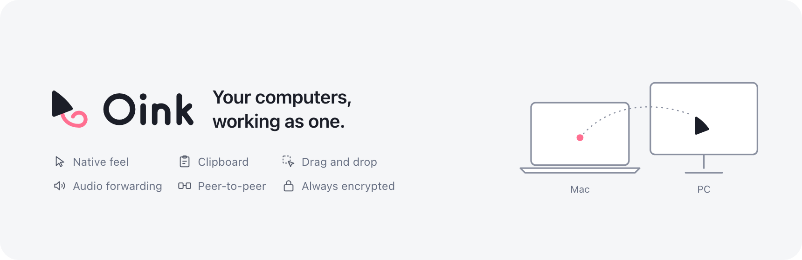

# Oink 專案解析：不依託任何舊血統的軟 KVM



**Oink**（`oinkvm/oink`）名字是「Oink Is Not only a KVM」的迴環縮寫（跟「GNU Is Not Unix Only」同一種梗），定位一句講完：**把你多台 Mac 與 Windows 電腦連成一個點對點網路，鍵盤、滑鼠、觸控板、剪貼簿、拖曳、音訊全部跨機共用**——一台電腦接一套鍵盤，全組電腦都用它。

跟 [Deskflow](/deskflow-keyboard-mouse-sharing/) 那篇講過的「Synergy 正統血統」路線完全不同：Oink 的 FAQ 第一條就明講**跟 Deskflow 沒有關係、不用它的協定、也不相容任何既有軟體 KVM**，從零寫起的新協定。它 2026-10-19 才開倉，一個月衝到 2,500 多星，是这波 KVM 生態动荡里最年轻的後起之秀。


## 專案概況

| 項目 | 資料 |
|---|---|
| 倉庫 | [github.com/oinkvm/oink](https://github.com/oinkvm/oink) |
| 星數 / Fork | **2,515 / 237**（2026-11-21 查證） |
| 語言 / 授權 | **Rust**（前端 TypeScript）/ GPL-3.0-only **加附加條款** |
| 創建日期 | 2026-10-19（開倉才一個月） |
| 最新版本 | **v0.3.7**（2026-11-19）；**0.4.0-beta.86**（2026-11-13，支援手機） |
| 維護者 | **1 人**（hachiwii），0 個已合併 PR |
| 平台 | macOS 14.2+（Apple Silicon 與 Intel）／Windows 10 1809+ 與 Windows 11 |
| 安裝 | GitHub Releases 的 `.dmg` / `.msi`，附 `SHA256SUMS` 驗證 |

一個月發了 9 個版本（0.2.2 → 0.3.7 隔 27 天，其中 0.3.1 到 0.3.7 密集在 11 月的 17 天裡），這種發佈節奏本身就是單人全時投入的訊號。

## 為什麼這個时间点会出现新 KVM

軟體 KVM 這個老題目（滑鼠滑過螢幕邊界就「滑進」下一台電腦）最近两年不太平靜：Synergy 商業化後，開源分支一路走來 Synergy 1 → Barrier 維護停滯 → [Deskflow](/deskflow-keyboard-mouse-sharing/) 接棒，中間還掺過社群治理的爭議。結果就是 GitHub 上 2025 年底到 2026 年冒出一批「自寫協定、不帶舊包袱」的新專案，Oink 是其中星數漲得最快的一支。

它跟老玩家的关键分歧在架構選擇：**老派是「一台當伺服器、其他當客戶端」，Oink 是纯點對點**——任何一台接鍵盤滑鼠，就能控制其他任何一台，不需要指定谁是主控。断一台不影响其他台，也不存在單點故障。

## 核心功能

### 1. 輸入共用：鍵盤、滑鼠、觸控板

- 任何裝置的鍵盤／滑鼠／觸控板控制全組裝置，體驗跟本机一樣（原生手勢可轉送：切桌面、Mission Control 等）
- 觸控板手勢支援，但 Windows 端觸控板官方標注「未測試」
- 滑鼠滾輪可選「按行轉送」或「按格轉送」；遊戲等讀物理輸入的程式有「游標離開時讓出前景」開關，防雙端同時反應
- 游標事件有頻率上限設定（預設高到 500Hz，可調——也刚好是已知 issue 里「輸入積壓」爭議的来源）

### 2. 剪貼簿與跨機拖曳

- 剪貼簿自動全組同步，帶**去重**功能（同内容連拷多次只同步一次，不跟其他剪貼簿工具打架）
- 文字、圖片、檔案可以直接從一台**拖到另一台的程式裡**——README 特别點名「拖進 Chrome 也能用」，這是老派 KVM 一向做不好的地方
- macOS 端還預拉 16 MB 以内的檔案，貼下去更快
- **Paste as File**：Finder 或檔案資源管理器右鍵選單，把剪貼簿里的文字／圖片直接存成檔案

### 3. 音訊转发與麥克風共用

這是 Oink 跟 Deskflow／Synergy 拉开差距最大的功能：

- **多台電腦的聲音，集中到一台的揚聲器或耳機播放**；品質可選 Smooth／Quality／Lossless 三檔
- 音訊結束時先暂停播放再還回本机音效，避免串音
- **麥克風共用**：macOS 端裝一個 CoreAudio HAL 虛擬麥克風驅動（`OinkMicrophone.driver`，基于 libASPL），其他電腦可以共用這台的麥克風——0.3.6 起還加了「静音時停止擷取」省電細節

### 4. 解鎖系列：自動解鎖、同步解鎖、登入畫面

| 功能 | 說明 |
|---|---|
| 自動解鎖 | 游標從已解鎖電腦移到鎖屏的 Mac／Windows，Oink 用存好的密碼自動解鎖。密碼在儲存時驗證、**只加密存在那台電腦上** |
| 同步解鎖 | 手動解鎖一台，群組内其他鎖屏電腦跟著解鎖（預設關閉） |
| Windows 登入畫面 | 開機後出現的登入畫面也能從其他電腦操作；靠一個原生 Credential Provider V2 元件（`OinkCredentialProvider.dll`）實現，只註冊自己的 CLSID，**不包覆、不停用 Windows 原生登入方式** |
| 遠端鎖屏 | Windows 上按 Win+Shift+L 鎖「游標所在」那台，本机 Win+L 照舊鎖本机 |

Windows 這块的实作細節（DPAPI 加密、SYSTEM 專存目錄、_named pipe_ 拒絕遠端連線、30 秒待處理逾時、重啟不重放舊操作）寫在 `crates/oink-credential-provider/README.md` 里，是整个 repo 最「硬」的一份文件——解鎖密碼這種敏感資料的處理路径看得很明白。

### 5. 跨機螢幕佈局

把多台電腦的螢幕拼成一個_virtual 大螢幕_：

- 佈局里可以隱藏某台電腦的某塊螢幕，隱藏對全組生效；離線裝置也能整台隱藏或移動
- Windows 端開「系統内停用隐藏螢幕」後，系統層級也停用，游標不会溜出去
- 佈局可存快捷鍵，一組按鍵切佈局；中鍵／侧鍵也能当快捷鍵
- 「游標移到下一台」快捷鍵（按線上裝置清單順序輪跳）

### 6. 其他亮点

- **升級就拖檔案**：下載好的 DMG／MSI 直接拖進 Oink 視窗就開始升級
- 埠被占用時自動换埠；支援 Tailscale 组網
- Quicker 相容模式（Windows）：本机被控制時 Quicker 仍能正常用
- 0.4.0 beta 開始**支援手機裝置**（社群試用的主要是 Android），但明講早期 beta、協定不相容舊版、全組要一起升級

## 技術架構

單人專案但工作區切得很规整——Rust workspace 16 個 crate 加 4 個 app：

```
oink（Tauri 主介面）─ 本地 IPC（AgentApi: Request / Reply / ApiEvent）─┐
                                                                        │
crates/oink-agent（後端服務：發現、配對、路由、剪貼簿、狀態）───────────┘
 ├─ oink-locator      區域網路自動發現
 ├─ oink-network      連線層（直接連線／中继兩種路径）
 ├─ oink-protocol     自寫點對點協定
 ├─ oink-input        鍵盤滑鼠注入與轉送
 ├─ oink-routing      游標跨螢幕路由
 ├─ oink-clipboard    剪貼簿同步
 ├─ oink-audio        音訊转发（Smooth／Quality／Lossless）
 ├─ oink-display      螢幕佈局
 ├─ oink-update       自動更新（0.3.6 重寫過）
 ├─ oink-winsvc       Windows 系統服務（含 Credential Provider 的 Rust API）
 ├─ oink-credential-provider  Windows 解鎖密碼處理
 ├─ oink-crash / oink-telemetry  崩潰與效能回報（預設關閉）
 ├─ oink-autostart    開機自動啟動
 └─ oink-foundation   共通基礎層

apps: oink（前端）| audio-plugin（macOS 虛擬麥克風 HAL 驅動）
      | file-provider | finder-sync（macOS 檔案系統擴充）
```

- **前端**：React + 自家 [oink-ui](https://github.com/oinkvm/oink-ui) 元件庫，Tauri 壳（macOS 選單列／Windows 系統托盤）；介面跟後端分成两个程序，走本地 IPC 通訊
- **後端**：`oink-agent` 服務程序管發現、配對、路由、剪貼簿與持久狀態；Windows 端还有背景系統服務寫日誌檔
- **平台深坑各有一支**：macOS 的 HAL 音訊驅動（簽名、安裝流程、libASPL 授權清册都寫在 README）；Windows 的 Credential Provider DLL 獨立簽名、走 MSI 檔案表；macOS 端 Developer ID 簽名加 notarization  notarization，下載附 SHA256SUMS

## 隐私与安全

`PRIVACY.md` 寫得比多數新專案認真：

- 崩潰與效能回報**預設關閉**；開啟後只送 Sentry（欧盟資料區），保留 90 天
- 回報内容只有版本、粗略系統版本、组件與時間直方图——**不含螢幕、剪貼簿、鍵盤、音訊、檔案内容、檔名與主機名**，不送原始 dump，並明确關掉 Sentry 的 IP 推斷
- 没有持久裝置識別碼；本機診斷包只有你主动分享时才上传
- 啟動時會從 `oink.hachiwii.com` 抓一個贊助 QR 圖（除 IP 外不含個人資料）
- 網路流量預設加密

## 授權與開發模式

- **GPL-3.0-only 加附加條款**（GPL 第七條）： redistributed 時要保留「Oink」原專案名 Attribution、修改版要明白標示不是原版、不得用 Oink 名義為衍生產品背書。個人或商業使用一律免費、不需要另行取得授權；只給自已用、不分发修改版的話没有任何義務
- **不收 PR**：README 直白寫「没有人 review 程式碼」，bug 與功能建議一律走 Issues，還請使用者附上環境、診斷資料与重現步骤——「在真实環境使用并回傳反馈，就是对这个专案最大的贡献」
- **赞助就是付 AI 订阅费**：Ko-fi 赞助页明寫「帮我的 AI 订阅成本出资」。搭配「一人維護、不收 PR」的開發模式，这是一个坦承用 AI 輔助開發的專案——寫文章时不回避这个背景
- 介面目前支援英文、簡體中文、日文、韩文；社群已有 Issue 在**要求加繁体中文界面**（#90），繁中使用者暫時只能用英文或簡體

## 跟老玩家比

✅＝内建／⚙️＝要加條件／❌＝没有：

| 項目 | Oink | Deskflow | Synergy（商業版） | 硬體 KVM 切换器 |
|---|---|---|---|---|
| 架構 | 純點對點 | 伺服器／客戶端 | 伺服器／客戶端 | 硬體線路切换 |
| 授權／價格 | 免費開源（GPL+附加條款） | 免費開源（GPL-2.0） | 商業授權 | 一次性硬體成本 |
| 平台 | Mac／Windows（Linux 暫無） | Win／Mac／Linux／BSD | Win／Mac／Linux | 跟系統无关 |
| 剪貼簿同步 | ✅ 自動＋去重 | ✅ 基本同步 | ✅ | ❌ |
| 跨機拖曳進程式 | ✅ 可拖進 Chrome | ❌ | ⚙️ 商業版功能 | ❌ |
| 音訊转发 | ✅ 三檔品質 | ❌ | ❌ | ⚙️ 部分型号 |
| 麥克風共用 | ✅（macOS 虛擬麥克風） | ❌ | ❌ | ❌ |
| 自動解鎖 | ✅ 密码本机加密 | ❌ | ❌ | ❌ |
| 控制登入畫面 | ✅ Windows 原生 Provider | ⚙️ 要装服务、体验依环境 | ⚙️ 商業功能 | ✅ 硬體層級天然可用 |
| 跨機螢幕佈局 | ✅ 可存快捷鍵 | ✅ 相鄰螢幕拼版 | ✅ | ⚙️ 多埠切换器 |
| Linux | ❌ | ✅ 含 Wayland | ✅ | ✅ |

一句話定位差異：**Deskflow 胜在平台全與血統正，Oink 胜在「Mac 加 Windows 雙端」的整合深度**——音訊、麥克風、自動解鎖、拖進 Chrome 这些，老派两支一个都没有。不做 Linux 是它目前最大的平台缺口。

## 安裝與已知限制

| 項目 | 要求 |
|---|---|
| Mac | Apple Silicon 或 Intel，macOS 14.2+（Intel 版官方標注未測試） |
| Windows | x64，Windows 10 1809（build 17763）+ 或 Windows 11；10 版 22H2 以前未測試 |
| LTSC 系統 | 缺 WebView2，要先装 Microsoft Edge WebView2 Evergreen |
| SmartScreen | MSI 未買商業簽名時會提示「Windows 保護了你的電腦」，選「更多資訊 → 仍要運行」；UAC 显示_unknown publisher_ |
| 相容性 | 0.3.x 全組可與 0.3.0+ 互通；**0.4 beta 協定不相容舊版，全組必须一起升級** |

單人專案加激进發版節奏，issue 區也如實反映（開仓一个月 50 個開放議題）：

- 游標偶发漂移、頻繁切换時 Ctrl／Win 键卡住（#94、#73）
- Wi-Fi 下 `oink-winsvc` 管線逾時导致停控（#80）；音訊接收端偶发 300～400ms 空洞（#93）
- Windows 10 1809／LTSC 2019 启动缺入口点崩潰（#96）
- 0.4 beta 端有後端崩潰、剪貼簿造成大量碟写入（#79）这类早期版本问题
- **没有 Linux 版**；繁體中文介面尚未支援
- 單人維護、不收 PR、開發高度依赖 AI 輔助——品質全靠社群回傳反馈，这是亮点也是风险

## 總結评价

Oink 是这波 KVM 生態分裂里最激进的一支：不背旧協定包袱、纯點對點、把「軟 KVM」从「共用一套键盘」推到了「共用音訊、麥克風、解鎖、拖曳」的完整跨機工作區。Mac 加 Windows 雙平台使用者（特别是 Mac 為主、Windows 为辅的组合）目前沒有比它功能更完整的開源选择。

代价也很明白：開仓才一个月、beta 不相容、單人維護、Linux 缺席、品質靠社群试錯。適合「两台机器刚好都是 Mac／Windows、愿意当早期使用者、会认真回 issue」的人；企業环境或 Linux 混合环境，现在还是 [Deskflow](/deskflow-keyboard-mouse-sharing/) 的地盘。

## 方法說明

資料來源：GitHub API 當日驗證（倉庫元資料、`/releases` 前 9 笔、`/contributors`、開放議題前 30 笔）；倉庫内文件 `README.md`、`LICENSE-ADDITIONAL-TERMS.md`、`PRIVACY.md`、`apps/oink/README.md`、`apps/audio-plugin/README.md`、`crates/oink-credential-provider/README.md`；功能細節以各版 release notes 原文为准。星數与版本以 2026-11-21 查證為准。相關前文：[Deskflow：開源軟體版 KVM](/deskflow-keyboard-mouse-sharing/)。
